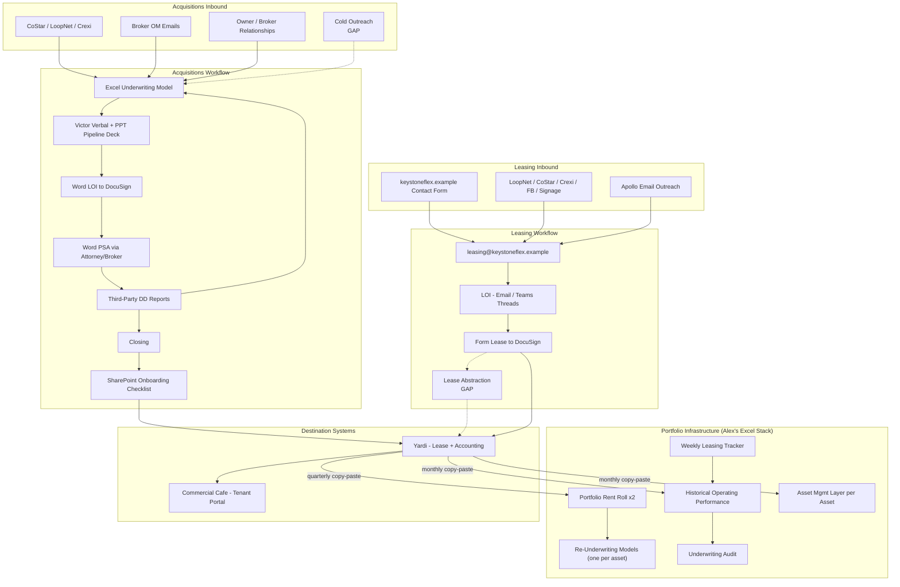

# **CLAUDE.md: KFP AI Audit Demo Build**

**Purpose.** Project context and demo build queue for Keystone Flex Partners (KFP). Use this file to orient any Claude session working in this repo on what to build, what data is available, and what's out of scope.

**Canonical sources.**
- The master Discovery Synthesis (maintained by Taylor Brooks, kept outside this repo) is the authoritative reference for findings, solutions, and priorities.
- `solution_builds.md` is the build-level companion: tech stack, repo structure, DB schema, per-demo specs, acceptance criteria. When implementing demos, read both this file and `solution_builds.md`.
- Pending synthesis adjustments (the L6 new addition) and per-interviewee working passes were kept alongside the master synthesis, outside this repo.
- Per-demo `process.md` files at each route directory (`/app/<demo>/process.md`) document the current vs demo process with source citations. Required for every active demo (A1, L1, L2, C3, A5).
- The 4-Jun validation session feedback is captured here and in `docs/superpowers/specs/2026-06-06-post-validation-demo-updates-design.md`; the three NEW solution tracks it surfaced are summarized under Phase 2 / Roadmap below.

When sources disagree, master synthesis wins for findings and priorities; `solution_builds.md` wins for build decisions.

---

## **Project Context**

KFP is a flex industrial real estate platform: multi-tenant flex warehouse units, typically 1,000-5,000 sqft per unit, leased to small businesses (contractors, e-commerce, distribution, light manufacturing). Long-term-hold strategy with a portfolio of a few dozen assets. Primary market: Marisol, a fictional coastal metro; expansion into other regional markets.

Key stakeholders for this audit (all names are fictional):
- **Victor**: principal / decision-maker, cares about yield-on-cost above all else.
- **Jordan Reyes**: platform overseer; runs acquisitions, oversees leasing, owns onboarding handoff. Primary audit interlocutor.
- **Alex Chen**: portfolio manager and analyst; built the entire Excel-based portfolio management infrastructure. Primary audit interlocutor.
- **Sam Patel**: KFP project sponsor and main client contact.
- **Taylor Brooks**: consulting-side lead; owns the master discovery synthesis.

Other KFP functions (referenced by team label, not by name, in client-facing materials):
- **Leasing team**: leasing manager + leasing associates, day-to-day deal flow.
- **Accounting team**: owns Yardi data entry and AP/AR.
- **Acquisitions team**: deal sourcing and underwriting models.
- **Property management team**.
- **Financing team**.
- **Incoming development lead** (development workflows deferred until they start).

---

## **Domain Glossary**

| Term | Meaning |
| --- | --- |
| CRE | Commercial Real Estate |
| PSA | Purchase and Sale Agreement (contract between buyer and seller for acquisition) |
| LOI | Letter of Intent (preliminary deal terms before contract) |
| DD | Due Diligence (30-45 day investigation period between PSA and closing) |
| OM | Offering Memorandum (marketing doc from broker describing a property for sale) |
| RFP | Request for Proposal (formal request to vendor for scope/timeline/price) |
| COI | Certificate of Insurance (vendor or tenant insurance verification) |
| PCA | Property Condition Assessment (DD report on building condition) |
| CapEx | Capital Expenditures (one-time investments in property improvements) |
| NOI | Net Operating Income |
| AUM | Assets Under Management |
| T-12 | Trailing 12 months operating statement |
| T-3 | Trailing 3 months operating statement |
| Yardi | KFP's property management / accounting system of record |
| CoStar / LoopNet / Crexi | External CRE listing and data services |
| AvidXchange | KFP's accounts payable system, holds historical invoice and proposal data |
| Commercial Cafe | Tenant portal for rent payment and service requests |
| Apollo | Email outreach tool currently used for tenant prospecting |
| Triple Net (NNN) | Lease where tenant pays rent + property taxes + insurance + maintenance |
| Modified Gross | Lease where landlord covers some operating expenses |

---

## **System Landscape**

Solid arrows = active flows. Dashed arrows = known gaps. L2 lease abstraction slots into the leasing workflow gap. The cold outreach gap was originally targeted by A2 but A2 was removed from the active build.

---

## **Demo Build Queue**

**Architecture target.** Single Next.js application with sidebar navigation. Five active demo tabs plus a home page. Shared SQLite database and shared Anthropic client. One repo, one deploy, one URL for the validation session. Full build spec, schemas, prompts, and acceptance criteria in `solution_builds.md`.

**Active demos:** A1 (Market Intelligence), A5 (Acquisition Lease Bulk-Load), L1 (Website Lead Qualification, structured form default plus a retained conversational chat option), L2 (single-lease Lease Abstraction), C3 (Lease Document Intelligence). L2 and C3 chain naturally as one walkthrough: lease in, abstract created, ask questions; the abstract editor has an "Ask C3 about this lease" deep-link and C3 citation panels link back to the L2 abstract. A5 feeds C3 in parallel: the leases inherited at a closing become C3's queryable corpus, and the vacant units become available-to-rent shells C3 can surface.

**Suite presentation (updated 2026-06-04).** The suite presents as a flat list of five demos on the Home grid (A1, C3, L2, A5, L1). The earlier Tier 1 / Tier 2 "we heard you" split is retired: it only existed to group the two reframes (L1 and A3), and A3 has now been declined and removed. A1, C3, L2, and A5 remain the validated headliners descriptively; L1 is the retained-and-warmed-to leasing intake. There is no Tier 2 reframe group anymore and no `/onboarding/blockers` route.

**Removed from active demo build:** A2 Voice Agent for Acquisition Cold Calling, per client decision on 2026-05-26. The reference script was kept internal for resumption. The Home grid no longer shows A2 (no card, no greyed placeholder).

Each demo carries a **status**:
- **BUILD NOW** = sufficient resources to build a meaningful proof of concept using public or synthetic data substitutes
- **BUILD PARTIAL** = can build core flow but a key piece needs real client data to land
- **FOLLOW-UP NEEDED** = blocked on client-side input that can't be substituted
- **REMOVED** = pulled from active build; reference materials preserved in `/docs/`

---

### **Demo A1: Market Intelligence Dashboard** (BUILD PARTIAL)

**Perspective:** Portfolio management serving Keystone acquiring underwriting decisions.
**Trigger:** Acquisition team is underwriting a deal or evaluating a new submarket.

**What it does.** A searchable dashboard that combines three data layers: (1) KFP's own portfolio rent roll across several hundred units, (2) extracted data from OMs (active and dead deals), (3) supplementary external feeds (CoStar/LoopNet/Crexi/county records). User filters by geography, unit size, asset type, lease structure, **bathroom Y/N**, **office Y/N**, **tenant category**, and **clear height**; gets achieved rent comps, transaction comps, and submarket aggregates with confidence scores tied to source quality. Selected comps surface an Underwriting Comparison section (comp rent vs UW rent, trended at lease, deviation %, Performance-to-UW, Leased / Vacancy / Combined Impact, with color-coded above/below flag) plus a Legacy vs KFP indicator. Tenant Category and Clear Height are KFP-acknowledged data gaps; the UI shows a "pending capture" badge where they're empty rather than hiding the gap.

**Yield-on-cost sensitivity table (added 2026-06-04, first pass).** The property underwriting panel now leads with a yield-on-cost sensitivity grid: **purchase price (rows) x stabilized rent per sqft (cols)**, each cell a yield-on-cost computed by the same `lib/uw.ts` engine (so the base cell matches the headline going-in / YoC figure), color-coded against a target yield, with a **cost-to-stabilize** sub-line and an assumptions footnote. This was Alex's primary desired A1 output (a sensitivity table of yield-on-cost against purchase price). The whole block is badged **"first pass"**: Alex is sending a written underwriting spec, and a second underwriting model plus ground-up development models are not yet provided, so this is shipped to refine later.

**Data model aligned with Alex's 54-column rent roll structure** (from the client's rent roll data-structure workbook):

- **Identity:** Property, Unit, Tenant Name.
- **Pre/post acquisition split:** Legacy Rent, KFP Rent, Legacy Term, KFP Term, Legacy SF, KFP SF. Alex tracks performance differently for what was inherited at acquisition vs what was signed under KFP ownership ([Discovery-Alex 04:46], [Discovery-Alex 08:00]).
- **Underwriting comparison:** Annual Rent PSF, Rent $/SF UW, Trended Rent at Lease, Performance to UW, Leased Impact to UW, Vacancy Impact, Combined Impact.
- **Filters:** Geography, Zip Code, County, Office (Y/N), Bathroom (Y/N), Tenant Category, Clear Height, Market Rent (Y/N).
- **Lease term tracking:** Lease From, Lease To, Annual Recovery PSF, Security Deposit.

The **Bathroom (Y/N) filter** is explicit and queryable: Jordan asked in pre-discovery about the rent and downtime delta for units with vs without private bathrooms, so the dashboard must answer that question.

`Tenant Category` and `Clear Height` columns are not currently captured in the KFP rent roll. The demo populates them only where the integrated solutions provide source data: Tenant Category from L1 (new prospect leasing flow), Clear Height from A1 OM ingestion. For existing portfolio units acquired before these solutions existed, those fields remain empty (surfaced with a "pending capture" badge) until a backfill process runs.

**Scope for demo:**
1. Ingest 3 sample broker OMs (Crestview → Gateway Commerce Center, Uptown → Riverside Flex Portfolio, Meridian) via pre-extracted JSON committed at `db/seed/extracted/{crestview,uptown,meridian}.json`; source PDFs are not part of this repo. The one-time extraction is owned by `scripts/pre-extract.ts`; the seed flow itself is LLM-free.
2. Vision-path extraction pipeline (Opus 4.7 native PDF) for runtime OM uploads; OMs are typically table-heavy with scanned exhibits where text-only PDF reads fall short.
3. Synthetic KFP-profile portfolio across the 8 seeded submarkets, populated at the corrected rent ranges and the legacy/KFP split.
4. Search interface with all filters above. The submarket and tenant-category lists are dynamic (`/api/submarkets`, `/api/tenant-categories` distinct-values endpoints) so any OM-ingested submarket or category appears as a filter option immediately.
5. Confidence scoring: high (signed lease) > medium (OM rent roll) > low (CoStar estimate).
6. UW comparison surface on the detail panel; OM upload toast surfaces propertyName + unitCount + submarket.

**Acceptance criteria:** Given a target submarket + unit size range + Bathroom filter, the dashboard returns at least 10 ranked rent comps with source attribution within 3 seconds. Uploading a fresh OM PDF results in a new property + unit rows landing within 60 seconds, with the new submarket appearing in the geo filter automatically.

**What's mock vs real:** Internal portfolio is synthetic (KFP-profile). The 3 seeded OMs are fictionalized from client-delivered samples, plus runtime upload of any OM PDF. Pre-extracted JSON committed; source PDFs are not in the repo.
**Follow-up to land production:** Real redacted KFP portfolio rent roll, backfill process for Tenant Category and Clear Height on legacy units.

---

### **Demo A2: Voice Agent for Acquisition Cold Calling** (REMOVED)

Pulled from the active demo build on 2026-05-26 at client request. The cold call script (buyer-not-broker positioning, 1-to-10 interest scale, mortgage status capture, Hot / Warm / Cold / Revisit disposition tags, TCPA compliance note for production launch) was preserved as an internal reference (not included in this repo).

To resume: lift the script into `lib/prompts/voice-script.ts`, re-introduce `callTargets` / `callOutcomes` schema, build the Vapi route per the prior implementation plan. Production launch is gated on TCPA legal review for automated voice agents addressing commercial property owners.

---

### **Demo A3: Property Onboarding** (DECLINED 2026-06-04)

**Considered, declined.** A3 (most recently scoped as a visibility-only consolidated cross-deal onboarding dashboard, after the auto-communication path was declined on the 29-May feedback) was declined outright by Jordan on the 4-Jun validation call and removed from the suite entirely. There is no longer an `/onboarding` route, an A3 Blocker Center, or any A3 components, APIs, prompts, seed, tests, or the `deals` / `onboarding_tasks` / `rfp_drafts` / `inbox_events` tables.

Jordan's reasoning (logged for the report):
- The deal process is **human-owned and unpredictable**; no two deals follow the same path.
- The onboarding checklist is an **aid, not the driver**; it does not run the deal.
- **Financing is a separate team**, iterative and relationship-driven; not a checklist item to automate.
- **DD RFP requests go to local handshake vendors** (~15 per year) and are trivial to copy-paste; an AI drafting layer adds no value.

A2 stays REMOVED (see below); A3 is now likewise out of the active build. The substance is preserved only as a declined-solution note in this file and the report.

---

### **Demo L1: Website Lead Qualification (form default plus retained chat option)** (BUILD NOW)

**Perspective:** Keystone leasing out.
**Trigger:** Prospect submits the structured leasing form on keystoneflex.example, or engages the conversational chat option.

**Chat warmed to on 2026-06-04.** On the 29-May feedback KFP had declined the conversational chat widget and asked for a structured form; L1 was reframed as the qualification backend behind that form. On the 4-Jun validation call Jordan **reversed that no** (he liked the chat more than expected and could see a use for it), gated on **cost vs. website traffic**; Taylor noted it is **multi-channel deployable** (email signature, referral intake), not tied to the site. So **both L1 versions are retained**: the structured form is the default shipped path, and the conversational chatbot is available via `?v=proposal`. No "chatbot was declined" framing remains for L1; the chat is a warmed-to option pending the cost vs. traffic call.

**What it does.** A structured qualification form captures the must-have fields directly: location, square footage, business type, business name, plus an open additional-criteria field; it never asks about budget. The conversational chat version captures the same fit signals through a transcript. On submit, the qualification engine reads the submission through the same KFP fit profile (flex industrial categories; 500-10,000 sqft band; Marisol plus expansion markets) and verdict rubric, and returns a verdict (qualified / unqualified / manual_review), a confidence score (0-100), and a one-sentence reasoning. A deterministic match-to-available-units step ranks the prospect's stated need against current vacant inventory (units with no tenant) by submarket and size band, rent-independent because empty shells carry no in-place rent, and attaches the matches to the lead. The enriched lead lands in the in-app Leasing Team Inbox with the verdict badge, confidence, reasoning, the structured submission view, and the matched-units panel; sort defaults to manual_review first, then qualified, then unqualified.

**Scope for demo:**
1. Structured qualification form (five fields) submitting to `POST /api/leads`; Keystone hosts the real form in production, the demo ships a representative one. The conversational chat version is retained and reachable via `?v=proposal`.
2. Qualification engine reused intact: KFP fit profile + verdict rubric, fed the form fields or the chat transcript.
3. Match-to-available-units: deterministic ranking against the seeded vacant inventory by submarket and size band, rent-independent.
4. Enriched lead record (verdict + confidence + reasoning + matched units) to the in-app Leasing Team Inbox + a notification on every lead.
5. Inbox UI with color-coded verdict badges, reasoning, the structured submission view, the matched-units panel, and the default manual_review-first sort.

**Acceptance criteria:** A form submission (or a chat session) produces a verdict + confidence + reasoning on the lead row plus a ranked set of matched vacant units, lands in the inbox without a manual refresh, and fires a notification; the inbox sorts review-priority first. The bot never asks about budget. Both `/chat-leasing` (form) and `/chat-leasing?v=proposal` (chat) render.

**What's mock vs real:** Qualification engine and matcher real. The representative form and chat are for the walkthrough; Keystone builds and hosts the production front end. Property/unit data fabricated; the matcher reads the seeded inventory.
**Follow-up to land production:** The cost vs. website-traffic call on the chat; production form / chat integration on keystoneflex.example (and the multi-channel surfaces Taylor noted); real unit-availability feed; real CRM destination.

---

### **Demo L2: Automated Lease Abstraction (single-lease Yardi-UI path)** (BUILD NOW)

**Perspective:** Keystone leasing out.
**Trigger:** A new lease is signed on an already-owned property.

**Scope of L2 (narrowed 2026-05-31).** L2 is the **single-lease path**: one person on the leasing team does the full Yardi create-through-activate sequence (create lease record, attach billing contact, add unit, build charge schedules, activate). L2 extracts the ~15-20 fields that sequence needs, before that person opens Yardi. Bulk acquisition inheritance (inheriting the seller's in-place leases at closing) is **A5's path, not L2's**. L2 is the foundation for C3 (with A5): the abstracts L2 produces become C3's negotiated-lease corpus, and A5 supplies the inherited bulk-loaded leases alongside them.

**What it does.** Lease PDF in, AI extracts key terms (parties, suite, dates, rent schedule, escalations, options, TI, free rent, security deposit, CAM, special provisions), produces a structured abstract, outputs paste-ready format for the leasing team's single-lease Yardi entry. The ~15-20 fields map directly to the five Yardi UI steps: tenant name and billing contact (steps 1 and 2), unit code and square footage (step 3), charge code, amount, and schedule dates (step 4), and the lease-level fields needed for activation (step 5).

**Operating-expense recovery extraction (added 2026-06-04).** L2 now extracts a structured `operatingExpenseRecovery` object as a first-class field: recovery type (NNN full, base-year stop, modified gross, gross/none, custom), base year, recovery method, pro-rata share %, expense categories, annual cap %, and reconciliation basis (calendar vs lease year), plus a verbatim/summarized notes clause. This was **Alex's top L2 ask**, the most billing-critical Yardi field (he singled it out as one of the most important things to get right and bill accurately in Yardi), and pass-throughs vary by lease (legacy, form, negotiated). Scope is the **stated lease terms only**: the demo does not model reconciliation math against budgets or expense data (out of scope; there is no budget data in the lease). The recovery clause(s) are captured into `rawSections` so C3 can cite them, the field renders in the AbstractEditor "Recoveries" group (low-confidence items fall into "Needs review"), and the recovery setup (type + base year + method + share) is shown in the Yardi paste-ready modal alongside the EstUtil line so the leasing team sees how the recovery is billed. C3 can answer "what is the OpEx recovery for [tenant]?" with a citation.

Two extraction paths handle the real client document mix:

- **Text-native path** (e.g., the KFP form lease, executed via DocuSign): `unpdf` text extraction first, Claude Sonnet 4.6 for term parsing.
- **Vision path** (e.g., legacy scanned leases: documents where no text-native version exists and the leasing team re-keys by hand; full-page CCITT gray images at 400 DPI, ~16 characters of extractable text across all pages): Claude Opus 4.7 with native PDF document support, page by page.

The pipeline auto-routes on upload by running text extraction on page 1 and measuring char count (threshold ~200 chars). The chosen path is stored in extraction metadata for transparency.

**Yardi paste-ready output** maps directly to the actual KFP rent roll columns (from Alex's rent roll data-structure workbook):

| Lease abstract field | Rent roll column |
| --- | --- |
| Tenant legal name | Tenant Name |
| Suite designation | Unit |
| Proportionate share (%) | % of RSF |
| Annual rent | Annual Rent |
| Annual rent / unit SF | Annual Rent PSF |
| Lease start | Lease From |
| Lease end | Lease To |
| Security deposit | Security Deposit |
| Lease type (NNN / MG / Gross) | Lease Type |
| Tenant business type (parsed from entity name) | Tenant Category (currently empty in KFP rent roll) |

**Scope for demo:**
1. Both seeded sample leases (text-native KFP form lease + scanned legacy lease) pre-extracted locally via `scripts/pre-extract.ts` and shipped as committed JSON in `db/seed/extracted/{keystone-lease,legacy-lease}.json`. Source PDFs stay gitignored.
2. Dual-path extraction pipeline with auto-routing on page-1 char count.
3. Confidence scoring per field, low-confidence items flagged in a "Needs review" group at the top of the editor.
4. **Manual upload intake.** Signed leases enter by manual upload of the executed PDF (exported from DocuSign) via the "Upload signed DocuSign lease (PDF)" affordance, inserting a `source = "upload"` + `status = "awaiting_review"` abstract. Automated DocuSign intake (DocuSign Connect / envelope webhook) is intentionally out of scope.
5. **Review queue + Approve workflow**: lease list filters to Awaiting Review for new arrivals; reviewer opens the abstract, corrects low-confidence fields inline, clicks "Approve and push to Yardi" which flips `status = "pushed_to_yardi"` and stamps `pushedToYardiAt`.
6. Yardi paste-ready modal showing the column-mapped output in the leasing team's paste order, plus the operating-expense recovery setup (type + base year + method + share) alongside the EstUtil line.
7. Operating-expense recovery extraction: the `operatingExpenseRecovery` object (stated terms only) on the abstract, surfaced in the AbstractEditor "Recoveries" group, with the recovery clause captured into `rawSections` for C3 citations and a per-field confidence entry.
8. Storage in `leaseAbstracts` table (now including an `operatingExpenseRecovery` JSON column) plus synchronous FTS5 index write for C3 (new abstracts queryable in C3 within seconds).
9. Narrative panel contrasting current quarterly-lag workflow with demo's same-day flow. "Ask C3 about this lease" deep-link from the abstract editor.

**Acceptance criteria:** Both seeded lease samples extract at >85% accuracy on key terms (tenant name, suite, lease dates, rent schedule, security deposit, escalation structure) and yield a populated `operatingExpenseRecovery` with confidence. The pipeline picks the right extraction path automatically and surfaces which path ran. Uploaded leases land in the review queue immediately; Approve drains the queue and stamps the timestamp. The AbstractEditor shows the Recoveries group, the Yardi modal shows the recovery setup + EstUtil, and C3 answers "what is the OpEx recovery for [tenant]?" with a citation.

**What's mock vs real:** The two seeded leases are fictionalized from client-delivered samples (source PDFs gitignored at `db/seed/lease-fixtures/`, not in this repo). Pre-extracted JSON committed. DocuSign intake is a manual upload of the signed PDF (DocuSign Connect / envelope-webhook integration intentionally excluded for now). Yardi destination stubbed (paste-ready output mapping to real rent roll columns). Bulk acquisition inheritance is out of L2's scope; that path is A5.
**Follow-up to land production:** Yardi API or import format determination, leasing team screen recording of current Yardi entry workflow. (Automated DocuSign intake via Connect or a mailbox watcher is intentionally deferred; intake stays a manual upload of the signed PDF.)

**L3 note.** L3 (Yardi Data Entry Automation) was retired as a standalone item in the 2026-05-31 restructure. Its substance is absorbed here: the single-lease Yardi-UI path is L2, the bulk path is A5. The manual lease-by-lease Yardi data-entry pain is kept as justification for both, not as its own solution.

---

### **Demo A5: Acquisition Lease Bulk-Load** (BUILD PARTIAL)

**Perspective:** Acquisitions (the Acquisitions team triggers the bulk load; the Accounting team reviews the emitted tables instead of typing them).
**Trigger:** A deal closes and Keystone inherits the seller's in-place leases from the closing rent roll and unit inventory.

**What it does.** A5 ingests a closing rent roll plus unit inventory and emits the six linked Yardi commercial ETL tables (CommLeases, CommUnitXrefs, CommUnits, CommSQFTs, CommChargeSchedules, CommContacts), keyed on `Property_Code` + `Lease_Code` (plus `Unit_Code` for unit-level tables), in a single deterministic pass. Occupied units fan out across all six tables (one CommLeases, one or more CommUnitXrefs and CommUnits and CommSQFTs per unit, one CommChargeSchedules per charge, one billing CommContacts). Vacant units land as CommUnits plus CommSQFTs shells only, available to rent, so newly inherited vacancy cannot fall through. This replaces the lease-by-lease hand entry the Accounting team does at every acquisition (slow and error-prone). A bulk-load summary card shows the counts (leases, occupied units, vacant shells, total SF) and a tabbed six-table preview shows each table's row count and a readable sample, tagging the occupied six-table fan-out vs the vacant two-table shells so the difference reads at a glance. The worked example is the **Foundry deal**, a recently closed ~two-dozen-tenant flex park, authored as occupied leases plus a few illustrative vacant shells (see the seed data for the exact roster).

A5 also feeds C3: the inherited leases become C3's queryable corpus (`leaseAbstracts.source = "bulk_load"`), and the vacant shells become the available-to-rent units C3's availability path surfaces.

**Scope for demo:**
1. The deterministic fan-out transform (`lib/etl/fan-out.ts`) over the zod-typed six-table schema (`lib/etl/yardi-tables.ts`): occupied -> 6 tables, vacant -> CommUnits + CommSQFTs only.
2. The committed Foundry dataset at `db/seed/extracted/acquisition-bulk-foundry.json` (tenant roster and security deposits patterned on the deal's PSA schedule, with fictional tenant names and perturbed amounts; unit sizes, rents, and dates modeled off a reference Yardi ETL export and Harbor Park One ranges, since the rent roll itself was only an attachment reference in the PSA).
3. `POST /api/acquisition/bulk-load` (emit the six tables + counts, persist the inherited leases and vacant units) and `GET /api/acquisition/preview` (summary counts). No LLM call; the transform is deterministic.
4. The `/acquisition-bulk-load` route: a closing-rent-roll panel (select the Foundry worked example; live `.xls` ingest shown as a disabled "needs Yardi access" affordance), the bulk-load summary card, and the tabbed six-table preview.

**Acceptance criteria:** Selecting the Foundry worked example emits the six ETL tables with the fan-out invariants holding (every occupied lease across all six tables; every vacant unit a CommUnits + CommSQFTs shell with no lease linkage; every row carrying `Property_Code`, lease-scoped rows carrying `Lease_Code`, unit-scoped rows carrying `Unit_Code`), reports the expected lease and vacant-shell counts, and the inherited leases become queryable in C3.

**What's mock vs real:** The tenant roster and security deposits are patterned on a real PSA schedule but fictionalized (invented names, perturbed amounts). The rest of the rent roll is modeled on a reference Yardi ETL export. The demo runs on the committed dataset, not a live ingest. Yardi stays a read-only destination; the six tables are a generated review artifact, not persisted Drizzle tables.
**Follow-up to land production:** Yardi access for a live closing `.xls` ingest and a confirmed Yardi import path for the emitted ETL tables.

---

### **Demo C3: Lease Document Intelligence (chains with L2 and A5)** (BUILD NOW)

**Perspective:** Keystone leasing out (internal use by property managers and leasing team).
**Trigger:** Property manager, leasing associate, or asset manager queries the lease database in natural language.

**Prerequisite corpus (BOTH L2 and A5).** C3 queries the lease corpus produced by both L2 (single-lease abstraction: the negotiated and form leases) AND A5 (Acquisition Lease Bulk-Load: the seller's in-place leases inherited at the Foundry closing, source `bulk_load`, plus the vacant unit shells). L2 supplies the negotiated-lease detail; A5 supplies the bulk-loaded inherited leases and the empty-and-rentable units the availability path reads.

**What it does.** Chat interface over the lease abstract database (the L2 abstracts plus the A5 bulk-loaded leases). User asks "tenant emailed about HVAC at their suite in Linwood Commerce Park. Whose responsibility?" System returns an answer with citation to the lease section and a link to the source. Also handles expiration ladders, renewal lists, net-effective-rent comparisons, lender-consent / loan-document lookups, a per-property tenant expiration schedule as structured output, an operating-expense-recovery lookup (citing the L2 recovery section), and a "what is empty and rentable" availability query over the A5 vacant shells.

**Richer default outputs (added 2026-06-04).** Alex wanted more on first look. Two changes:
- **Size + rent/sqft auto-included.** Expiration and schedule answers now carry **unit size and rent per sqft** beside the dates automatically (extra Size and Rent/SF columns in the schedule block), so the user does not have to ask a second question. Terse queries (e.g., just a property name) return the headline rental items (tenant, suite, size, rent/sqft, lease end, renewal) by default rather than asking the user to narrow.
- **Anticipated NOI-lift stat.** Per-property expiration queries surface an **anticipated NOI-lift** headline: the sum over leases expiring in the window of `max(0, marketRentPsf - inPlaceRentPsf) x sizeSqft`, where `marketRentPsf` comes from `lib/uw-assumptions.ts`, the **same A1 market-rent assumptions, so A1 and C3 agree**. It is a clearly-labeled estimate (market-rent assumptions, not signed comps).

**Role-tiered display** is a roadmap note only (a dev-config decision per the call), not built.

**Scope for demo:**
1. Reuse the L2 lease abstracts plus the A5 bulk-loaded inherited leases (source `bulk_load`) and the vacant unit shells.
2. Retrieval layer over the DB: SQLite FTS5 over `rawSections` with prefix matching (`term*`), stopword filter, and per-lease rebalance (max 2 sections per lease in the pool) so a single tenant doesn't crowd out the rest.
3. Structured side paths: (a) expiration / renewal queries inject a synthetic "Lease Dates (system)" section with the explicit `leaseEnd` date to cite; (b) net-effective-rent queries pull every lease's Free Rent + TI + Base Rent sections so the LLM can compute NER per lease; (c) a per-property tenant expiration schedule grouped by `propertyAddress` and rendered as a typed `schedule` block, each row now carrying unit size and rent per sqft, with an anticipated NOI-lift stat above it (from the `lib/uw-assumptions.ts` market rents); (d) a loan-document / lender-consent side-path that cites the real "Lender Consent and Loan Documents" section on the inherited leases; (e) an availability side-path that surfaces the A5 vacant shells (`units.tenantName IS NULL`); (f) an operating-expense-recovery side-path that surfaces the L2 recovery section for the named (or all) leases.
4. Chat interface (web UI) with **eight suggested-query chips**. These are FlexOps AI-curated example prompts grounded in Jordan's stated use cases, not a verbatim client list: (1) HVAC responsibility for a tenant, (2) per-property tenant expiration schedule for the Foundry property, (3) leases expiring next quarter, (4) compare net effective rents across the negotiated leases, (5) lender consent / loan docs for a tenant, (6) renewal options summary across the portfolio, (7) which leases have free rent in year 1, (8) which leases have TI allowance over $10 per square foot. The A5-fed "what is empty and rentable" availability query runs alongside.
5. Citation generator: every answer includes lease id, section heading, page, and exact quote.
6. Bi-directional cross-link with L2: arriving via `/lease-intelligence?leaseId=X` auto-fires an opening query; citation panel surfaces an "Open in L2" deep-link back to the abstract editor.

**Acceptance criteria:** Given a natural-language question about a specific tenant or unit, the system returns the correct answer with citation in under 5 seconds. The eight example chips return meaningful results with at least one citation each; the per-property expiration query returns a typed schedule block with Size and Rent/SF columns and, where in-place rents are below market, an anticipated NOI-lift stat; a terse query returns headline rental items; the loan-doc query cites a real inherited-lease section; the OpEx-recovery query cites the L2 recovery section; the availability query surfaces the A5 vacant shells.

**Build chains with L2 and A5.** Position L2 + C3 together as one connected demo: "lease in, abstract created, ask questions." A lease uploaded in L2 is queryable in C3 within seconds; A5 supplies the inherited corpus and the vacant shells in parallel.

**What's mock vs real:** Same lease data as L2 plus the A5 bulk-loaded Foundry leases. The lender-consent answers are sourced from the seeded "Lender Consent and Loan Documents" section, not from parsing real loan agreements. The empty-and-rentable units are the A5 vacant shells; vacant counts are illustrative.
**Follow-up to land production:** Production lease library, real loan-document parsing, a live Yardi availability feed, role-based access controls.

---

### **Phase 2 / Roadmap (not in current demo build)**

- **L3 Yardi Data Entry Automation.** Retired as a standalone item in the 2026-05-31 restructure. Its substance is absorbed by L2 (the single-lease Yardi-UI path) and A5 (the bulk path). The 5+ hours/week of manual data entry per closing is kept as justification for L2 and A5, not as its own solution.
- **L4 Voice Agent (Tenant Prospecting).** Same tech as A2, lower priority.
- **L5 AR/Delinquency Workflow.** Not flagged as priority by Alex or Jordan.
- **L6 Leasing Inbox Enrichment Agent (from adjustments doc).** Depends on L2 being in place. Phase 2.
- **P1 Portfolio Management Application.** Multi-quarter umbrella build. Position as architecture vision in the report, not a demo.
- **P2 Automated Re-underwriting Assistance.** Depends on P1 data layer.
- **P3 Closed-loop Move-out Tracking.** Yardi event watcher dependency.
- **A4 Cost Estimating Database.** Medium priority per master synthesis.
- **C1 Email Listener for Jordan.** Requires Jordan's real Gmail rules; not demoable from synthetic data.
- **C2 AI Meeting Transcription.** Off-the-shelf tool recommendation (Fireflies). No custom build.

**New solution tracks from the 4-Jun validation session (not in the demo build).** Three opportunities surfaced during the 4-Jun demo; all are scoping/report material, summarized here:
- **Portfolio Absorption Reporting** (NEW, authorized by Jordan; standalone, not folded into A5). Period-over-period tenant absorption at asset and portfolio level over the platform's unified unit/lease data. Alex co-designs the output; Sam forwards his V1 file; dedicated working session.
- **Historical Operating Performance Reporting** (NEW, qualify). Connects underwriting, budgets, income-statement performance, and re-underwriting; overlaps P1. Alex and Sam review the file in person before forwarding; qualify feasibility now.
- **Website-to-Yardi Vacancy Sync** (NEW, low priority, report item). A one-way read-only Yardi-to-website availability sync; gated on Yardi read access and Sam's cybersecurity note, plus the photo/description gap. Owner to consult: the website owner.

---

## **Explicitly Out of Scope**

- Victor presentation automation (Jordan's deliberate boundary).
- Excel underwriting model rebuild (functional, not burdensome per Jordan).
- Development pipeline workflows (deferred to the incoming development lead).
- Commercial Cafe tenant portal (property management territory).
- Yardi internal architecture changes.

---

## **Mock Data Strategy**

When client data is unavailable, fabricate data that matches KFP's profile:

- **Properties:** Multi-tenant flex industrial buildings, 30,000-100,000 sqft total per building, 10-30 units per building, primarily Marisol (Parkhurst, Calder, Brightwater, Ashby Beach, Westbrook) plus other regional markets for expansion.
- **Units:** 1,000-5,000 sqft, biased to 1,500-2,500 sqft. Some with private bathrooms (premium). Office Y/N is a separate flag.
- **Rents (updated 2026-05-31):**
  - Marisol flex industrial, built-out Modified-Gross units (office + bathroom): **$27-$30/sqft**, anchored on the Harbor Park One rent roll (Westbrook, Office Y + Bathroom Y, Modified Gross, built-out).
  - Marisol flex industrial, office + bathroom units (NNN): **$20-$35/sqft NNN**.
  - Marisol flex industrial, raw warehouse units (no office, no bathroom): **$13-$20/sqft NNN**.
  - Expansion markets (other regional markets): **$11-$18/sqft NNN**.
- **Tenants:** Small businesses; per Jordan and the KFP form lease, the realistic mix includes contractors (HVAC, plumbing, electrical), e-commerce fulfillment, light manufacturing, distribution, **auto design and auto services** (e.g., Hartwell & Sons Auto Design, LLC, per the KFP form lease sample), metal fabrication, cabinet shops, print shops.
- **Leases:** Mostly 3-5 year terms, annual 3-5% escalations, triple net, TI allowances modest ($5-15/sqft).
- **Client samples (delivered by Sam on 2026-05-26):** Three broker OMs (Crestview, Uptown Realty Advisors, Meridian), two lease samples (KFP form lease text-native + legacy scanned lease), Alex's rent roll data-structure workbook, and cold call notes. Source files stay out of the repo (gitignored `db/seed/{om,lease}-fixtures/`). Pre-extracted, fictionalized JSON outputs are committed to `db/seed/extracted/` so the deployed app gets the same baseline.

- **Underwriting (added 2026-05-31):** A1 derives underwriting the Keystone way, replacing the prior flat `rent x 0.92` placeholder. `lib/uw-assumptions.ts` stores per-submarket assumptions: comp-derived market rent benchmark (low/high band midpoint), acquisition basis $/sqft, rent growth rate (5% core, 3.5% expansion), MG NOI margin, stabilized vacancy (5%), reserves $/sqft, acquisition/selling cost %, and CapEx-to-demise $/sqft. `lib/uw.ts` runs two functions. `underwriteUnit` computes per-unit outputs: `rentUw` = submarket market rent (not the unit's own in-place rent), `performanceToUw` = (in-place minus market) / market (negative = below market = upside, the Keystone signal), and `trendedRentAtLease` = market compounded at the rent growth rate from lease start to as-of date. `underwriteProperty` computes property-level outputs from the unit set: going-in cap rate = in-place NOI / acquisition price; market rent range (low/high) from the submarket assumptions; mark-to-market upside = (market minus weighted in-place) / weighted in-place; stabilized NOI = market rent x total SF x (1 - vacancy) x NOI margin x (1 + rent growth); yield-on-cost = stabilized NOI / all-in cost (acquisition price + acq costs + CapEx + reserves); basis $/sqft. Property metrics are computed at read-time in `app/api/properties/[id]/units/route.ts` with no DB columns and no migration. The Foundry property uses deal-level inputs (basis, market rent band, rent growth, CapEx; fictional figures, see the seed data); the engine computes the going-in cap from these inputs. The same engine runs at seed time and at runtime OM upload, so synthetic, OM-ingested, and Foundry properties are all methodology-consistent. A `sensitivityMatrix` function (added 2026-06-04) reuses the same `underwriteProperty` math to build the A1 yield-on-cost grid (purchase price rows x stabilized rent/sqft cols), so the base cell matches the property's headline going-in / YoC figure; it is also computed at read time with no DB columns. The same `lib/uw-assumptions.ts` market rents feed the C3 anticipated NOI-lift stat, so A1 and C3 agree.

---

## **Follow-up Needed from Client (Priority 1 blockers)**

Before any demo lands production, we need from Sam:
1. Sanitized real OM sample (preferably 2-3 from different brokerages).
2. Sanitized real form lease + one negotiated lease.
3. Redacted or sample portfolio rent roll from Alex.
4. Cold calling script confirmation from Jordan (bullet-point email is enough).
5. Sanitized PSA sample.
6. Yardi API capability confirmation.
7. Leasing team screen recording of Yardi lease entry.
8. **Alex's written A1 underwriting spec**, plus the **second underwriting model** and the **ground-up development models** (the A1 sensitivity table is a "first pass" until these land).
9. **Portfolio Absorption Reporting:** Alex's V1 absorption Excel + a sample of the desired in-platform output (Sam forwarding; dedicated working session).
10. **Historical Operating Performance Reporting:** Alex's historical operating performance file (sanitized) once he and Sam review it in person.

(The lender-packet ask is resolved/closed: A3 was declined and removed on 2026-06-04, so there is no lender packet to validate. Revisit only if the client later requests a standalone lender-packet generator.)

---

## **Open Decisions Tracker**

- Leasing manager session: yes or no, and timing. Several leasing demos touch the leasing team.
- Voice agent pilot market(s): expansion markets only or also core markets.
- L1 conversational chat: cost vs. website-traffic call (Jordan warmed to it on 4-Jun; viability gated on this). Both versions are retained pending the decision; consider the multi-channel surfaces Taylor noted (email signature, referral intake).
- A1 underwriting: the sensitivity table is a **first pass** pending Alex's written underwriting spec, a second underwriting model, and ground-up development models.
- New solution tracks: Portfolio Absorption Reporting (authorized, dedicated working session), Historical Operating Performance Reporting (qualify), Website-to-Yardi Vacancy Sync (low priority). Summarized under Phase 2 / Roadmap.
- P1 reuse scope: does the portfolio application architecture need to be reusable across the owner's other real estate strategies?

**Resolved.** A3 lender packet / RFP auto-drafts: **closed** with A3's removal on 2026-06-04 (the auto-communication path had already been declined on principle on 29-May; A3 itself is now declined entirely). The prompt files `lib/prompts/lender-packet.ts`, `draft-rfp.ts`, and `extract-psa.ts` were removed with A3. If the client later wants a lender-packet generator as a standalone tool, it is a new scoping conversation.

---

## **Build Conventions for Claude Code**

High-level conventions live here. Detailed tech stack, repo structure, and per-demo specs in `solution_builds.md`.

- **Solution coding.** Use Taylor's master IDs (A1-A5, L1-L5, P1-P3, C1-C3) plus L6 from adjustments. A5 is the Acquisition Lease Bulk-Load demo, formally added to the vocabulary in the 2026-05-31 suite restructure, so it is no longer an "invented ID". Do NOT introduce any other new IDs without explicit instruction.
- **Perspective + trigger.** Every solution doc starts with these two fields. Acquiring vs leasing out vs portfolio management vs cross-cutting.
- **Yardi.** Treat as read-only system of record. No writes back to Yardi from any demo without explicit integration confirmation.
- **No client data in repo.** Real client samples go in gitignored locations: runtime uploads to `/uploads/`, pre-seed source PDFs to `db/seed/{om,lease}-fixtures/`. Pre-extracted JSON outputs ARE committed at `db/seed/extracted/` so the deployed app has the same baseline as local without shipping the source documents.
- **Conciseness.** Each solution spec fits within one page including data flow. Detailed dev specs live in `solution_builds.md`, not in synthesis or this brief.
- **No em dashes.** Use commas, semicolons, or periods. Applies to code, comments, UI copy, and any document in this repo.
- **Current vs Demo Process documentation.** Every active demo carries a `process.md` at its route directory with four sections: Current Process (numbered steps with source citations), Demo Process (replaces / augments / new / out-of-scope tags), Mapping table, What the demo does NOT cover. Source citations use the form `[Discovery-Jordan HH:MM:SS]`, `[Discovery-Alex HH:MM:SS]`, `[Pre-discovery-Jordan]`, `[Pre-discovery-Alex]`, `[Kick-off HH:MM:SS]`, `[Validation 2026-06-04]` for the 4-Jun demo + validation session, or `[Cold call notes]` / `[Rent roll structure]` for delivered artifacts.
- **Tech stack defaults** (full detail in `solution_builds.md`): Next.js 15 App Router, TypeScript strict, shadcn/ui, Drizzle + SQLite, Anthropic SDK with `claude-sonnet-4-6` as default and `claude-opus-4-7` for high-stakes extraction, zod for LLM output validation.
- **Migrations are hand-authored.** `pnpm db:generate` (drizzle-kit) is unusable in this repo: the meta snapshots are frozen at `0001` while migrations run to `0011`. Author new migrations by hand, matching the `0002`-`0011` SQL convention, and update `db/schema.ts` to match. Do not rely on `db:generate`.

---

*Last updated: based on the master discovery synthesis (21 May 2026) + adjustments + pre-discovery questionnaire ingest.*
