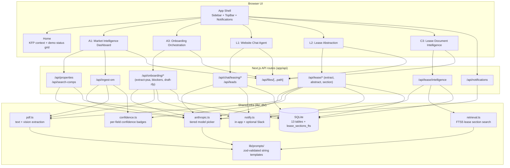

# System Overview

A single Next.js application with a sidebar shell that hosts five demo routes plus a home page. One repo, one deploy, one URL for the validation session. All demos share a single SQLite database, a single Anthropic SDK client, and a common UI shell.

## Layered view

## How the five demos relate

| Demo | Perspective | Trigger | Depends on |
| --- | --- | --- | --- |
| A1 Market Intelligence | Portfolio mgmt → acquiring | Submarket evaluation | Properties + units + OM ingestion |
| A3 Onboarding Orchestration | Acquiring | PSA signed | Deals + onboarding tasks + RFP drafts |
| L1 Website Chat | Leasing out | Prospect visits site | Leads + chat sessions; populates Tenant Category for A1 |
| L2 Lease Abstraction | Leasing out | Lease signed | Lease abstracts; feeds C3 retrieval (`rawSections` → FTS5) |
| C3 Lease Intelligence | Leasing out (internal) | NL question over lease library | L2 abstracts; FTS5 virtual table |

A2 Voice Agent was removed from the active build on 2026-05-26; its reference script was kept internally.

## Shared infrastructure layers

- **UI shell** (`components/shell/`): sidebar nav, top bar, notifications bell, status grid on Home.
- **Shared components** (`components/shared/`): PDF uploader, viewer, confidence badge, citation card, streaming response wrapper.
- **API layer** (`app/api/`): Next.js route handlers, grouped per demo plus shared `/api/files/[...path]` for serving anything inside `uploads/`, `db/seed/*-fixtures/`, or `docs/`.
- **LLM layer** (`lib/anthropic.ts`, `lib/prompts/`): tiered model picker (Sonnet 4.6 default, Opus 4.7 high-stakes, Haiku 4.5 fast); all prompts live in `lib/prompts/` as string templates with zod-validated output schemas.
- **PDF extraction** (`lib/pdf.ts`): dual-path extraction (text via `unpdf`, vision via Anthropic native PDF document support) with auto-routing on page-1 char count. See `docs/architecture/pdf-pipeline.md`.
- **Retrieval** (`lib/retrieval.ts`): FTS5 over `lease_sections_fts` virtual table for C3.
- **Confidence scoring** (`lib/confidence.ts`): per-field confidence maps stored as JSON in `lease_abstracts.extraction_confidence` and rendered as badges in L2/A1.
- **Data layer** (`db/`): Drizzle ORM over `better-sqlite3`; 13 tables plus an FTS5 virtual table; see `docs/architecture/data-model.md`.
- **External destinations**: in-app notifications by default; Slack webhook activates when `SLACK_WEBHOOK_URL` is set. Yardi is read-only (paste-ready output only, no integration). Voice platform deferred with A2.
