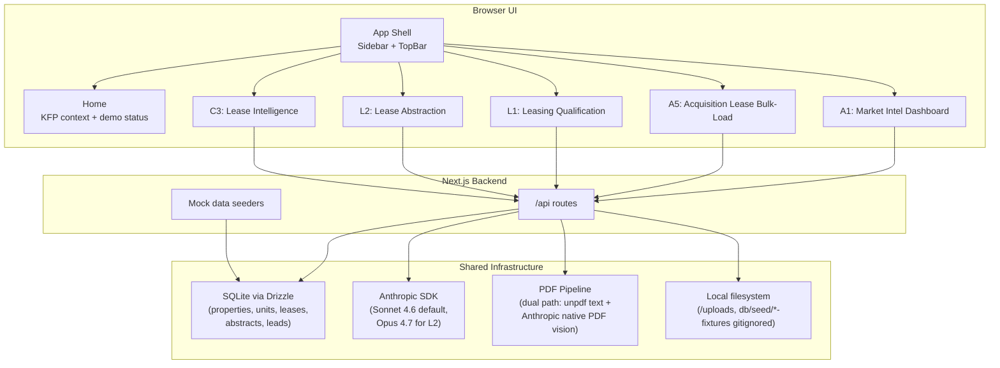

# **solution_builds.md: KFP Demo Suite Build Spec**

**Purpose.** Detailed build specifications for the KFP AI audit demo suite. Each demo has tech stack, data model, UI structure, backend contracts, LLM integration, mock data spec, demo flow, acceptance criteria, plus a Current vs Demo Process subsection that maps the existing manual workflow to what the demo automates.

**Companion document.** `CLAUDE.md` holds the higher-level audit context, glossary, and out-of-scope items. This file is the build-level companion. The 4-Jun validation feedback applied on this branch is captured in the design spec `docs/superpowers/specs/2026-06-06-post-validation-demo-updates-design.md`; the three NEW solution tracks it surfaced (Portfolio Absorption Reporting, Historical Operating Performance Reporting, Website-to-Yardi Vacancy Sync) are scoping / report material, summarized in `CLAUDE.md` (Phase 2 / Roadmap) and not part of this build.

**Architecture target.** Single Next.js application with sidebar navigation. Five active demo tabs (A1, C3, L2, A5, L1) plus a home page. A2 (Voice Agent) was removed from the active build on 2026-05-26 per client decision and its script kept as an internal reference (not in this repo, not shown on the Home grid). A3 (Property Onboarding) was declined by Jordan on the 4-Jun validation call and removed entirely (no `/onboarding` route, no Blocker Center; see the declined note in section 3). Shared SQLite database and shared Anthropic client. One repo, one deploy, one URL for the validation session.

---

## **1. Architecture Overview**

### **1.1 Shell**

A single-page application shell with a left sidebar listing the five active demos (A1, C3, L2, A5, L1) plus Home, rendered as a flat list (the Tier 1 / Tier 2 "we heard you" split was retired on 2026-06-04 when A3 was declined). Each demo is a route within the same Next.js app, sharing layout, theme, and the shared infrastructure layer. The presenter walks through demos by clicking sidebar tabs. A2 is fully removed from the Home grid; its reference script was kept internally for resumption only. A3 was declined on 2026-06-04 and removed entirely.



### **1.2 Tech Stack**

| Layer | Choice | Notes |
| --- | --- | --- |
| Framework | Next.js 15 (App Router) | Full-stack, file-based routing, server actions |
| Language | TypeScript (strict mode) | Required for type-safe data models across LLM extractions |
| UI components | shadcn/ui | Sidebar, Card, Dialog, Table, Button, Input, Tabs, Toast |
| Styling | Tailwind CSS v4 | shadcn/ui dependency |
| Icons | lucide-react | shadcn standard |
| Database | SQLite via better-sqlite3 | File-based, zero infra, persists between sessions |
| ORM | Drizzle ORM | Lightweight, type-safe, fast |
| LLM client | @anthropic-ai/sdk | Default model `claude-sonnet-4-6`; escalate to `claude-opus-4-7` for high-stakes extraction |
| PDF extraction | unpdf for text, Claude vision API for tables/scanned PDFs | unpdf is modern, lightweight, no native deps |
| Validation schemas | zod | LLM structured output validation |
| Voice platform | Vapi.ai | A2 only; SDK + webhook |
| State / data fetching | TanStack Query (client), Server Components (static) | Minimum complexity |
| File storage | Local `./uploads/` directory | Demo only; production would use S3 |
| Deployment | Vercel | Optional; local dev works for live demo |
| Package manager | pnpm | Faster than npm, deterministic |

### **1.3 Repo Structure**

```
kfp-demo-suite/
├── CLAUDE.md
├── solution_builds.md
├── package.json
├── tsconfig.json
├── tailwind.config.ts
├── drizzle.config.ts
├── .env.local                       # ANTHROPIC_API_KEY, VAPI_API_KEY
├── /db/
│   ├── schema.ts                    # Drizzle table definitions
│   ├── migrate.ts
│   └── seed/
│       ├── properties.ts            # Synthetic KFP-profile properties
│       ├── units.ts
│       ├── leases.ts
│       └── om-fixtures/             # Public OM PDFs for A1 demo seeding
├── /lib/
│   ├── anthropic.ts                 # Configured Anthropic client
│   ├── pdf.ts                       # Shared PDF extraction utility
│   ├── prompts/
│   │   ├── extract-om.ts
│   │   ├── extract-lease.ts
│   │   ├── voice-script.ts
│   │   ├── leasing-chat.ts
│   │   └── lease-intelligence.ts
│   ├── uw.ts                        # Underwriting engine + sensitivityMatrix (A1)
│   ├── uw-assumptions.ts            # Per-submarket market-rent assumptions (A1 + C3 NOI-lift)
│   └── confidence.ts                # Confidence scoring helpers
├── /app/
│   ├── layout.tsx                   # App shell with sidebar
│   ├── page.tsx                     # Home page
│   ├── /market-intelligence/        # A1
│   ├── /voice-agent/                # A2 (removed from active build)
│   ├── /acquisition-bulk-load/      # A5
│   ├── /chat-leasing/               # L1 (form default + retained conversational chat)
│   ├── /lease-abstraction/          # L2 (single-lease Yardi-UI path; L3 retired, absorbed by L2 + A5)
│   ├── /lease-intelligence/         # C3
│   └── /api/
│       ├── ingest-om/
│       ├── search-comps/
│       ├── voice/start/
│       ├── voice/webhook/
│       ├── acquisition/bulk-load/
│       ├── acquisition/preview/
│       ├── leads/
│       ├── lease/extract/
│       └── lease/intelligence/
├── /components/
│   ├── shell/Sidebar.tsx
│   ├── shell/TopBar.tsx
│   ├── shared/PDFUploader.tsx
│   ├── shared/ConfidenceBadge.tsx
│   ├── shared/CitationCard.tsx
│   └── shared/StreamingResponse.tsx
└── /uploads/                        # Runtime PDF storage (gitignored)
```

### **1.4 Shared Database Schema**

The shared SQLite database backs every demo. Defined in Drizzle.

```typescript
// db/schema.ts (sketch : Claude Code to flesh out)

export const properties = sqliteTable('properties', {
  id: text('id').primaryKey(),
  name: text('name').notNull(),
  address: text('address'),
  submarket: text('submarket'),               // e.g. "Olmstead", "Westbrook"
  state: text('state'),
  totalSqft: integer('total_sqft'),
  assetType: text('asset_type'),              // "flex industrial", "warehouse"
  yearBuilt: integer('year_built'),
  source: text('source'),                     // "internal", "om", "costar"
  sourceDocId: text('source_doc_id'),
  ingestedAt: integer('ingested_at', { mode: 'timestamp' }),
});

export const units = sqliteTable('units', {
  id: text('id').primaryKey(),
  propertyId: text('property_id').references(() => properties.id),
  suite: text('suite'),
  sizeSqft: integer('size_sqft'),
  leaseType: text('lease_type'),              // "NNN", "MG", "Gross"
  hasPrivateBathroom: integer('has_private_bathroom', { mode: 'boolean' }),
  currentRent: real('current_rent'),
  rentPerSqft: real('rent_per_sqft'),
  leaseStart: integer('lease_start', { mode: 'timestamp' }),
  leaseEnd: integer('lease_end', { mode: 'timestamp' }),
  tenantName: text('tenant_name'),
});

export const leases = sqliteTable('leases', {
  id: text('id').primaryKey(),
  unitId: text('unit_id').references(() => units.id),
  pdfPath: text('pdf_path'),
  ingestedAt: integer('ingested_at', { mode: 'timestamp' }),
});

export const leaseAbstracts = sqliteTable('lease_abstracts', {
  id: text('id').primaryKey(),
  leaseId: text('lease_id').references(() => leases.id),
  tenantName: text('tenant_name'),
  landlordName: text('landlord_name'),
  propertyAddress: text('property_address'),
  suite: text('suite'),
  leaseStart: integer('lease_start', { mode: 'timestamp' }),
  leaseEnd: integer('lease_end', { mode: 'timestamp' }),
  baseRentSchedule: text('base_rent_schedule'),    // JSON: [{ from, to, monthlyRent, annualRentPerSqft }]
  escalations: text('escalations'),                // JSON
  renewalOptions: text('renewal_options'),         // JSON
  tiAllowance: real('ti_allowance'),
  freeRentMonths: integer('free_rent_months'),
  securityDeposit: real('security_deposit'),
  camTerms: text('cam_terms'),                     // JSON
  // Operating-expense recovery, stated lease terms only (added 2026-06-04, Alex's top L2 ask).
  operatingExpenseRecovery: text('operating_expense_recovery'), // JSON: { recoveryType, baseYear, recoveryMethod, proRataSharePct, expenseCategories, capPct, reconciliationBasis, notes }
  estimatedRecoveryPsf: real('estimated_recovery_psf'),         // EstUtil $/sqft hint used by the Yardi modal
  useClause: text('use_clause'),
  specialProvisions: text('special_provisions'),   // JSON
  extractionConfidence: text('extraction_confidence'),  // JSON per-field
  extractionPath: text('extraction_path'),         // "text" | "vision"
  rawSections: text('raw_sections'),               // JSON: [{section,page,text}] feeds C3 FTS5
  extractedAt: integer('extracted_at', { mode: 'timestamp' }),
  // L2 review workflow (2026-05-27)
  source: text('source'),                          // "seed" | "upload" | "docusign"
  status: text('status'),                          // "awaiting_review" | "approved" | "pushed_to_yardi"
  pushedToYardiAt: integer('pushed_to_yardi_at', { mode: 'timestamp' }),
});

export const leads = sqliteTable('leads', {
  id: text('id').primaryKey(),
  source: text('source'),                          // "chat", "voice", "form"
  // Tier 1 must-haves
  businessType: text('business_type'),
  businessName: text('business_name'),
  spaceSizeSqft: integer('space_size_sqft'),
  location: text('location'),
  // Tier 2
  timeline: text('timeline'),
  leaseTermYears: real('lease_term_years'),
  // Tier 3
  existingLocations: text('existing_locations'),
  motivation: text('motivation'),
  loadingNeeds: text('loading_needs'),
  callbackPreferred: integer('callback_preferred', { mode: 'boolean' }),
  rawTranscript: text('raw_transcript'),
  tierMap: text('tier_map'),                       // JSON: { [field]: "tier1"|"tier2"|"tier3" }
  // Qualification verdict (2026-05-27)
  verdict: text('verdict'),                        // "qualified" | "unqualified" | "manual_review"
  confidenceScore: integer('confidence_score'),    // 0-100
  reasoning: text('reasoning'),                    // one-sentence explanation
  createdAt: integer('created_at', { mode: 'timestamp' }),
});

// Notifications drive L1 / L2 / A5 surfaces. The A3-only columns
// (task_id, team, event) and the deals / onboarding_tasks / rfp_drafts /
// inbox_events tables were dropped on 2026-06-04 when A3 was declined and
// removed (migration 00XX_remove_a3, hand-authored per the migration note).
export const notifications = sqliteTable('notifications', {
  id: text('id').primaryKey(),
  kind: text('kind'),                              // qualified_lead | extraction_complete | bulk_load_complete | ...
  title: text('title'),
  body: text('body'),
  link: text('link'),
  createdAt: integer('created_at', { mode: 'timestamp' }),
  readAt: integer('read_at', { mode: 'timestamp' }),
});

export const callTargets = sqliteTable('call_targets', {
  id: text('id').primaryKey(),
  propertyId: text('property_id').references(() => properties.id),
  ownerName: text('owner_name'),
  ownerPhone: text('owner_phone'),
  status: text('status'),                          // "pending", "calling", "completed"
  outcome: text('outcome'),                        // "interested", "not_interested", "no_answer", "wrong_number"
  transcript: text('transcript'),
  hotLeadFlag: integer('hot_lead_flag', { mode: 'boolean' }),
  calledAt: integer('called_at', { mode: 'timestamp' }),
});

export const sourceDocuments = sqliteTable('source_documents', {
  id: text('id').primaryKey(),
  type: text('type'),                              // "om", "lease", "psa", "internal_rent_roll"
  filename: text('filename'),
  pdfPath: text('pdf_path'),
  ingestedAt: integer('ingested_at', { mode: 'timestamp' }),
});
```

### **1.5 Shared Mock Data Strategy**

Seed scripts populate the DB with KFP-profile synthetic data at first run. Each demo can also accept user-uploaded data at runtime, which lands in the same tables alongside seeds.

**Seed targets at first run:**
- 8 properties: 5 in Marisol (Parkhurst, Calder, Brightwater, Westbrook), 3 in expansion markets (Kingsley, Orrington, Altamont)
- 80-120 units across these properties (10-15 per property)
- 6 synthetic lease abstracts (mix of form and negotiated leases), 3 of which carry a non-null `operatingExpenseRecovery` spanning the three shapes (one NNN full pass-through, one base-year stop with base year + cap, one gross/none), each of those with a recovery rawSection for C3 citations; the remaining abstracts leave `operatingExpenseRecovery` null (silent leases)
- 20-30 call targets across 1-2 fabricated markets
- 5-10 OMs ingested from public CRE listing sources (committed to `/db/seed/om-fixtures/`)

**Profile parameters for synthetic data:**
- Unit sizes: 1,000-5,000 sqft, biased to 1,500-2,500 sqft
- Rent range: $11-$15/sqft NNN for Marisol, $9-$13/sqft for expansion markets
- Tenant types: HVAC, plumbing, electrical contractors, e-commerce fulfillment, light manufacturing, distribution, auto services, fabrication
- Lease terms: 3-5 years, 3-5% annual escalations, modest TI ($5-15/sqft)
- Private bathroom flag: ~20% of units (premium feature per Jordan's pre-discovery)

---

## **2. Build Order**

Dependencies determine the build sequence. Numbered demos can be built in parallel within the same group.

**Group 1 (foundations):**
1. App shell + sidebar navigation + home page
2. Shared DB + Drizzle setup + seed scripts
3. Shared Anthropic client + prompt module structure
4. Shared PDF pipeline (text extraction + vision)

**Group 2 (independent demos):**
5. L1 Leasing Qualification (no PDF, no shared data dependency)
6. A2 Voice Agent (depends on Vapi setup, otherwise independent)

**Group 3 (PDF-dependent demos):**
7. L2 Lease Abstraction (depends on PDF pipeline)
8. A1 Market Intelligence Dashboard (depends on PDF pipeline)
9. A5 Acquisition Lease Bulk-Load (deterministic fan-out; no PDF dependency, feeds C3)

**Group 4 (chained demos):**
10. C3 Lease Intelligence (depends on L2 abstracts existing in DB)

Order rationale: shell first to give every other demo a place to land. Independent demos before PDF demos because PDF pipeline has the most failure modes. C3 last because it consumes L2's output.

---

## **3. Demo Specs**

Each demo follows the same template: perspective + trigger, UI, data, backend, LLM, mock data, demo flow, acceptance.

---

### **Demo A1: Market Intelligence Dashboard**

**Perspective:** Portfolio management serving Keystone acquiring underwriting decisions.
**Trigger:** Acquisitions team is underwriting a deal or evaluating a new submarket.

#### **UI Components**

- **Layout:** Three-column. Left: filter sidebar (geo multi-select **fetched dynamically from `/api/submarkets`**, unit size range slider, asset type, lease type, **Bathroom Y/N**, **Office Y/N**, **Tenant Category multi-select fetched from `/api/tenant-categories`**, **Clear Height range**). Center: results grid (sortable table of unit comps with rent/sqft, source, confidence, plus Tenant Category, Bathroom Y/N column, Clear Height column). Right: detail panel (selected comp full record + source citation + **Underwriting Comparison section** + **Legacy vs KFP indicator**).
- **Top action bar:** "Ingest OM" button (opens PDF upload modal), search bar (free text). OM upload on success fires a toast surfacing `propertyName` + `unitCount` + `submarket` and invalidates the search-comps / submarkets / tenant-categories caches so the UI updates immediately.
- **Aggregate header:** count, median rent PSF, min/max.
- **Confidence badges** on every comp: high (verified signed lease), medium (OM rent roll), low (CoStar estimate).
- **Pending-capture badges** on Tenant Category and Clear Height where empty (acknowledged data gaps until backfill).
- **Source citation card** on detail panel: filename + page + extraction confidence + raw quote, with link to the source PDF (served via the file allowlist).
- **Yield-on-cost sensitivity table** (added 2026-06-04, first pass): the headline of the Property Underwriting section in `CompDetailPanel.tsx`. A grid with purchase price (rows) x stabilized rent per sqft (cols), color-coded YoC cells, a target line, a cost-to-stabilize sub-line, and an assumptions footnote, badged "first pass". The unit-level Underwriting Comparison renders below it.
- **Underwriting Comparison section** on detail panel: comp rent vs UW rent, trended at lease, deviation %, Performance-to-UW, Leased / Vacancy / Combined Impact with color-coded above/below flag.

#### **Data Model (aligned with the client's rent roll data-structure workbook)**

The 54-column KFP rent roll structure maps onto these Drizzle tables:

```typescript
// Properties get acquisition + filter metadata
export const properties = sqliteTable('properties', {
  id: text('id').primaryKey(),
  name: text('name').notNull(),
  address: text('address'),
  submarket: text('submarket'),
  state: text('state'),
  totalSqft: integer('total_sqft'),
  assetType: text('asset_type'),
  yearBuilt: integer('year_built'),
  // 54-col additions
  geography: text('geography'),                  // city or polygon name
  zipCode: text('zip_code'),
  county: text('county'),
  hasOffice: integer('has_office', { mode: 'boolean' }),
  clearHeightFt: real('clear_height_ft'),
  acquisitionDate: integer('acquisition_date', { mode: 'timestamp' }),
  marketRentYn: integer('market_rent_yn', { mode: 'boolean' }),
  source: text('source'),                        // "internal" | "om" | "costar"
  sourceDocId: text('source_doc_id'),
  ingestedAt: integer('ingested_at', { mode: 'timestamp' }),
});

// Units carry the full Alex-rent-roll column set
export const units = sqliteTable('units', {
  id: text('id').primaryKey(),
  propertyId: text('property_id').references(() => properties.id),
  suite: text('suite'),
  sizeSqft: integer('size_sqft'),
  leaseType: text('lease_type'),                 // "NNN" | "MG" | "Gross"
  hasPrivateBathroom: integer('has_private_bathroom', { mode: 'boolean' }),
  // Current rent + lease
  currentRent: real('current_rent'),             // monthly $
  rentPerSqft: real('rent_per_sqft'),            // annual $/sqft
  annualRent: real('annual_rent'),
  leaseStart: integer('lease_start', { mode: 'timestamp' }),
  leaseEnd: integer('lease_end', { mode: 'timestamp' }),
  termYears: real('term_years'),
  tenantName: text('tenant_name'),
  tenantCategory: text('tenant_category'),       // null until backfill or L1 capture
  // Legacy vs KFP split (per Alex 04:46, 08:00)
  legacyRent: real('legacy_rent'),
  kfpRent: real('kfp_rent'),
  legacyTermYears: real('legacy_term_years'),
  kfpTermYears: real('kfp_term_years'),
  legacySf: integer('legacy_sf'),
  kfpSf: integer('kfp_sf'),
  // Underwriting comparison
  rentUw: real('rent_uw'),                       // $/sqft underwritten
  trendedRentAtLease: real('trended_rent_at_lease'),
  performanceToUw: real('performance_to_uw'),
  leasedImpactUw: real('leased_impact_uw'),
  vacancyImpactUw: real('vacancy_impact_uw'),
  combinedImpactUw: real('combined_impact_uw'),
  // Recovery + deposit
  annualRecoveryPsf: real('annual_recovery_psf'),
  securityDeposit: real('security_deposit'),
  // Share + ABR
  proportionateShareRsf: real('proportionate_share_rsf'),
  pctOfAbr: real('pct_of_abr'),
});

// compConfidence stays as-is for OM-derived rows
export const compConfidence = sqliteTable('comp_confidence', {
  id: text('id').primaryKey(),
  unitId: text('unit_id').references(() => units.id),
  rentConfidence: text('rent_confidence'),       // "high" | "medium" | "low"
  sourceType: text('source_type'),               // "signed_lease" | "om_rent_roll" | "costar_estimate"
  rawQuote: text('raw_quote'),
  extractedFromPage: integer('extracted_from_page'),
});
```

`Tenant Category` and `Clear Height` are currently empty in the real KFP rent roll. The demo populates them via:
- L1 captures `tenantCategory` for new prospect leases (the structured qualification form collects business type directly from the form submission).
- A1 OM ingestion captures `clearHeightFt` from acquisition OMs.
- For legacy portfolio units, both fields stay null until a backfill process runs; the dashboard surfaces a "pending capture" badge.

#### **Backend APIs**

- `POST /api/ingest-om` accepts a PDF upload, runs the vision-path extraction (Opus 4.7 native PDF), writes properties + units + compConfidence rows. Returns `propertyId`, `propertyName`, `unitCount`, `submarket` for the success toast.
- `POST /api/search-comps` accepts filter params (`submarkets[]`, `minSqft`, `maxSqft`, `assetType`, `leaseType`, `hasBathroom`, `hasOffice`, `tenantCategories[]`, `clearHeightMin`, `clearHeightMax`), returns ranked comps with aggregates (count, median rent PSF, min/max) plus per-row Tenant Category, Clear Height, Bathroom, Office, Legacy/KFP split values.
- `GET /api/properties/:id/units` returns full unit detail for a property (including the UW comparison columns and tenant category) plus `sourceDoc` metadata, the property-level underwriting block, and the yield-on-cost sensitivity matrix (price x stabilized rent/sqft) computed at read time.
- `GET /api/submarkets` returns distinct submarkets present in `properties` (dynamic, so OM-ingested submarkets appear automatically).
- `GET /api/tenant-categories` returns distinct tenant categories present in `units`.

#### **LLM Integration**

Model: `claude-opus-4-7` via vision-path (OMs typically ship as scanned PDFs with rent-roll tables). The `extractWithVision` helper auto-streams when `maxTokens` exceeds the SDK's 10-minute non-streaming ceiling.

Prompt structure (in `/lib/prompts/extract-om.ts`): system prompt instructs the model to extract property metadata (`name`, `address`, `submarket`, `state`, `totalSqft`, `assetType`, `yearBuilt`, `zipCode`, `county`, `hasOffice`, `clearHeightFt`) and unit-level rent roll data (including `tenantCategory` inferred from tenant name). JSON output validated via the `OMExtraction` zod schema before DB write.

#### **Mock Data**

- Three client-sample broker OMs delivered by Sam on 2026-05-26 (Crestview → Gateway Commerce Center, Uptown → Riverside Flex Portfolio, Meridian), fictionalized in this public version. Source PDFs are not in this repo. The one-time extraction is owned by `scripts/pre-extract.ts`, which writes committed JSON to `db/seed/extracted/{crestview,uptown,meridian}.json`. Seed reads the JSON via `db/seed/oms.ts` and inserts `sourceDocuments` + `properties` (`source = "om"`) + `units` (with `tenantCategory`) + `compConfidence` rows. **`pnpm db:seed` is LLM-free**; re-run the pre-extraction script only when the source PDFs change.
- Synthetic KFP-profile internal portfolio across the 8 seeded submarkets, populated at the corrected rent ranges in `CLAUDE.md`, with `legacyRent` / `kfpRent` split values populated. Built-out Modified-Gross Marisol units (office + bathroom, lease type MG) are calibrated to **$27-30/sqft**, anchored on the Harbor Park One rent roll (Westbrook, Office Y + Bathroom Y, Modified Gross, built-out). Other bands: office+bath NNN $20-35/sqft Marisol, raw warehouse $13-20/sqft Marisol, expansion markets $11-18/sqft.
- Bathroom Y/N and Office Y/N seeded plausibly across the unit set so the bathroom-delta query has real distribution to work with.

#### **Underwriting Engine**

A1 derives underwriting the Keystone way via two modules.

**`lib/uw-assumptions.ts`** holds per-submarket underwriting assumptions as a typed `UwAssumptions` record:

| Field | What it represents |
| --- | --- |
| `marketRentPsf` | Midpoint of the submarket rent band; the per-unit UW benchmark |
| `marketRentLow` / `marketRentHigh` | Band bounds surfaced on the property detail panel |
| `acquisitionBasisPsf` | Basis $/sqft used to compute acquisition price and going-in cap |
| `rentGrowthPct` | Annual rent growth rate (5% core, 3.5% expansion markets) |
| `noiMargin` | In-place NOI as a fraction of in-place contract rent (Modified Gross recoveries offset opex; currently 1.0) |
| `vacancyPct` | Stabilized vacancy assumption (5%) |
| `reservesPsf` | Capital reserves $/sqft included in all-in cost |
| `acqCostPct` | Acquisition and selling cost % applied to purchase price |
| `capexToDemisePsf` | CapEx-to-demise $/sqft included in all-in cost |

`getUwAssumptions(submarket, { isBuiltOut, isExpansion })` selects the correct rent band (MG built-out vs NNN premium vs raw warehouse) and returns the full assumptions record. A `FOUNDRY_UW` constant overrides with the Foundry deal-level inputs (basis $/sqft, market rent band and benchmark, rent growth, CapEx $/sqft; fictional figures, see `lib/uw-assumptions.ts`).

**`lib/uw.ts`** runs two functions.

`underwriteUnit(input): UnitUw` -- per-unit underwriting:
- `rentUw`: submarket market rent midpoint (the UW benchmark, not the unit's own in-place rent).
- `performanceToUw`: (in-place rent minus market) / market. Negative = below market = upside, which is the Keystone acquisition signal. Null for vacant units.
- `trendedRentAtLease`: market rent compounded at `rentGrowthPct` from lease start to as-of date (fixed to `SEED_AS_OF = "2026-05-31"` for deterministic seed outputs).
- `leasedImpactUw` / `vacancyImpactUw` / `combinedImpactUw`: dollar impact of in-place vs market over the unit SF.

`underwriteProperty(units, assumptions, totalSqft): PropertyUw` -- property-level underwriting computed from the full unit set:
- `goingInCapPct`: in-place NOI / acquisition price (acquisition price = basis $/sqft x total SF).
- `marketRentLow` / `marketRentHigh`: surfaced from the submarket assumptions; the market rent range band.
- `markToMarketUpsidePct`: (market minus weighted in-place PSF) / weighted in-place PSF.
- `inPlaceNOI` / `stabilizedNOI`: in-place = contract rent x NOI margin; stabilized = market rent x total SF x (1 - vacancy) x NOI margin x (1 + growth).
- `yieldOnCostPct`: stabilized NOI / all-in cost (acquisition price + acq cost % + CapEx $/sqft + reserves $/sqft).
- `basisPsf`: the acquisition basis from assumptions.

Property metrics are computed at read-time in `app/api/properties/[id]/units/route.ts` and returned alongside the unit list. No DB columns were added and no migration is required. The same engine runs at seed time and at runtime OM upload, so synthetic, OM-ingested, and Foundry properties are all methodology-consistent. The Foundry property uses the `FOUNDRY_UW` deal-level inputs and reproduces the deal model's going-in cap.

`sensitivityMatrix(input): SensitivityMatrix` (added 2026-06-04) -- the A1 yield-on-cost sensitivity grid, Alex's primary desired A1 output. Axes are **purchase price (rows) x stabilized rent per sqft (cols)**. Rows default to the property's base purchase price stepped by [-7%, 0, +7%]; cols default to the submarket market-rent band (low / mid / high). Each cell is a yield-on-cost computed by the same math as `underwriteProperty`: `stabilizedNOI = rentPsf x totalSf x (1 - vacancy) x noiMargin x (1 + rentGrowth)`, `allInCost = price + acqCosts + costToStabilize + reserves`, `yieldOnCost = stabilizedNOI / allInCost`. The base cell (base price x mid rent) equals the property's headline going-in / YoC figure, so the grid and the headline agree. Cell tone: at or above the target yield = good (emerald), within ~1pt = mid (amber), below = low (rose). `costToStabilize = capexToDemisePsf x totalSf` (plus reserves), shown as a sub-line. Computed at read time in the same route; no DB columns. The whole block is badged **"first pass: pending Alex's written underwriting spec, a second underwriting model, and ground-up development models"** (none yet provided). The same `lib/uw-assumptions.ts` market rents feed the C3 anticipated NOI-lift stat, so A1 and C3 agree.

#### **Demo Flow**

1. Presenter opens A1 tab. Dashboard shows seeded portfolio + the 3 ingested real OMs.
2. Presenter toggles the Bathroom Y/N filter and observes the rent delta between bathroom and no-bathroom units (median PSF and count).
3. Presenter filters: submarket = Kingsley, unit size 1500-2500, leaseType NNN.
4. Result list shows the ranked comps with the legacy vs KFP indicator and Performance-to-UW where present.
5. Presenter clicks a comp from the Crestview OM. Detail panel shows the source citation with raw quote and a working link to the source PDF (locally only; deployed environment shows graceful unavailability).
6. Presenter clicks "Ingest OM" and uploads a new public OM PDF. Pipeline auto-routes (text or vision), new property + units land in the table within 30-60 seconds.

#### **Acceptance Criteria**

- [x] Upload a 20-page OM PDF and have it parsed into the DB within 60 seconds.
- [x] At least 80% of unit-level fields populate correctly on the seeded real OMs.
- [x] Filter combinations (geo + size + asset type + Bathroom Y/N + Office Y/N + Tenant Category + Clear Height) return ranked results in under 2 seconds.
- [x] Bathroom Y/N filter is explicit and queryable; the dashboard answers Jordan's pre-discovery question about rent and downtime delta for units with vs without private bathrooms.
- [x] Every comp displays a confidence badge with appropriate source attribution.
- [x] Clicking a comp shows the raw source quote and a working link to the source PDF (graceful unavailability message in deployed environments where the source PDF is not present).
- [x] Legacy vs KFP indicator visible on units with a populated split.
- [x] Underwriting Comparison section on the detail panel shows comp vs UW with deviation and impact metrics.
- [x] Selecting a property (especially Foundry) shows a yield-on-cost sensitivity grid (purchase price x stabilized rent/sqft) whose base cell matches the headline going-in / YoC figure, plus a cost-to-stabilize line and the "first pass" badge.
- [x] OM upload success toast surfaces propertyName + unitCount + submarket; new submarket appears in the filter sidebar automatically.

#### **Current vs Demo Process**

Source of truth lives at `app/market-intelligence/process.md`. Duplicated here so reviewers see it alongside the spec.

**Current Process (what KFP does today):**

1. Alex maintains two portfolio rent roll files in Excel with a shared 54-column structure: identity, rent, UW comparison, legacy/KFP split, filters [Discovery-Alex 02:58, 03:33].
2. Every quarter, signed-lease and occupancy data is copy-pasted from Yardi into the rent roll files [Discovery-Alex 07:26].
3. The leasing team logs each new lease in the leasing tracker (date, asset, tenant, deal type, unit, previous rent, new rent, term, lease structure) [Discovery-Alex 10:42].
4. Alex tags each lease as legacy (pre-acquisition) or post-acquisition by hand on the rent roll [Discovery-Alex 04:46, 08:00].
5. UW comparison: Alex trends the underwritten rent forward to each lease's start date at a growth rate, then computes performance-to-UW per unit [Discovery-Alex 03:33].
6. For new market evaluation, Alex and Jordan source OMs from CoStar, LoopNet, brokers; manually read each; copy useful comps into the master rent roll [Discovery-Jordan 14:06, Discovery-Alex 09:08].
7. For NNN vs MG normalization, Alex adds operating expenses back to non-NNN leases so rent comparisons are apples-to-apples [Discovery-Alex 06:00].

**Demo Process (what this solution does):**

1. Seeded KFP-profile portfolio plus three ingested broker OMs (fictionalized) load immediately on `/market-intelligence`. **(replaces)** Current step 2's quarterly copy-paste.
2. Filter sidebar exposes geo, unit size, asset type, lease type, plus Bathroom Y/N, Office Y/N, Tenant Category, Clear Height. **(replaces)** Manual Excel filtering.
3. Bathroom delta query answers Jordan's pre-discovery question in one click. **(new)**
4. "Ingest OM" runs the dual-path extraction pipeline on any uploaded PDF. **(replaces)** Current step 6's manual OM read.
5. Confidence-tiered comp results with raw-quote citations linking to source PDFs. **(new)**
6. Legacy vs KFP indicator on every unit derived from populated split columns. **(augments)** Current step 4's manual tagging.
7. Aggregate header surfaces Performance-to-UW when UW values present. **(augments)** Current step 5.
8. Yield-on-cost sensitivity table (first pass) leads the Property Underwriting section: price x stabilized rent/sqft grid of YoC plus cost-to-stabilize. **(new)** Alex's primary desired A1 output [Validation 2026-06-04], [Discovery-Alex].

**Mapping:**

| Current Step | Demo Step | Relationship | Notes |
| --- | --- | --- | --- |
| 1 (maintain rent roll files) | 1 (seeded portfolio) | replaces | Demo seed mirrors the 54-column structure |
| 2 (quarterly Yardi copy-paste) | 1 (seeded) | replaces | Production would integrate via Yardi API |
| 3 (leasing tracker logging) | n/a | out of scope | Lives in current process; demo reads downstream of it |
| 4 (legacy vs post-acq tagging) | 6 (indicator) | augments | Demo presumes seed/extraction populates the split |
| 5 (UW comparison) | 7 (perf-to-UW header) | augments | Same computation surfaced automatically |
| 6 (manual OM reading) | 4 (ingest-OM extraction) | replaces | Dual-path pipeline handles text and scanned OMs |
| 7 (NNN/MG normalization) | n/a | out of scope | Lease type filter surfaces the distinction; OpEx add-back deferred |
| new: yield-on-cost sensitivity | 8 (sensitivity table, first pass) | new | Alex's primary desired A1 output: price x stabilized rent/sqft YoC grid + cost-to-stabilize [Validation 2026-06-04] |

**What the demo does NOT cover:**

- Quarterly Yardi sync (production needs the integration).
- Operating expense add-back normalization for non-NNN leases.
- Backfill of Tenant Category and Clear Height on legacy portfolio units.
- Asset management presentations and the Victor weekly deck flow.
- The full underwriting model: the yield-on-cost sensitivity table is a first pass. Alex's written underwriting spec, a second underwriting model, and ground-up development models are not yet provided and are out of scope for this pass [Validation 2026-06-04].

---

### **Demo A2: Voice Agent for Acquisition Cold Calling (REMOVED)**

Pulled from the active demo build on 2026-05-26 at client request. The cold call script, qualifying questions, disposition tags (Hot / Warm / Cold / Revisit), and the TCPA compliance note were preserved as an internal reference (not included in this repo).

The previously-planned `callTargets` and `callOutcomes` tables, Vapi voice-agent integration, and `/api/voice/*` routes were removed from this codebase in an earlier version (2026-05-26). To resume the build, lift the preserved script into `lib/prompts/voice-script.ts`, re-introduce the schema, and follow the deferred A2 task block from the prior implementation plan.

Production launch is gated on TCPA legal review for automated voice agents addressing commercial property owners.

---

### **Demo A3: Property Onboarding (DECLINED 2026-06-04)**

A3 was declined by Jordan on the 4-Jun validation call and removed from the build entirely. There is no `/onboarding` route, no Blocker Center, and no A3 components, APIs, prompts, seed, or tests. The `deals`, `onboarding_tasks`, `rfp_drafts`, and `inbox_events` tables and the A3-only `notifications` columns (`task_id`, `team`, `event`) were dropped in a hand-authored migration `00XX_remove_a3.sql` (the `notifications` table itself stays; L1 / L2 / A5 use it). The `extract-psa`, `draft-rfp`, and `lender-packet` prompts were removed.

Jordan's reasoning (logged for the report): the deal process is human-owned and unpredictable; the onboarding checklist is an aid, not the driver; financing is a separate team, iterative and relationship-driven; and DD RFP requests go to local handshake vendors (~15 per year) and are trivial to copy-paste. A3 had earlier (29-May) been reframed from auto-communication to a visibility-only dashboard; on 4-Jun it was declined outright. See `docs/process/current-vs-demo-mapping.md` and the report for the declined-solution note.

---

### **Demo L1: Website Lead Qualification (form default + retained chat)**

**Perspective:** Keystone leasing out.
**Trigger:** Prospect submits the structured leasing form on keystoneflex.example, or engages the conversational chat option.

**Reframed 2026-05-31, updated 2026-06-04.** On the 29-May feedback KFP was building its own structured form, so L1 was rebuilt as the **qualification backend behind that form**. On the 4-Jun validation call Jordan **warmed to the conversational chat** (he liked the chat more than he expected and could see a practical use for it), gated on **cost vs. website traffic**; Taylor noted it is **multi-channel deployable** (email signature, referral intake). Both versions are now **retained**: the structured form is the default shipped path and the conversational chatbot is reachable via `?v=proposal`. The KFP fit profile and verdict rubric are shared by both (the engine is unchanged); a deterministic **match-to-available-units** step enriches each lead. No "chat declined" framing applies any longer.

#### **UI Components**

- **Layout:** Two-tab. Tab 1: a representative structured qualification form (the demo stand-in for Keystone's own production form), the default shipped path. Tab 2: "Leasing Team Inbox" lists leads with verdict badges (qualified / unqualified / manual review), confidence score, one-sentence reasoning, the structured five-field submission view, and the matched-units panel. Default sort: manual_review, then qualified, then unqualified, then createdAt desc.
- **Version toggle:** the conversational chatbot (`ChatProposalView`) is retained and reachable via `?v=proposal`; the structured-form view (`ChatLeasingTabs`) is the default. A `VersionBanner` explains the chat is warmed-to and pending the cost vs. website-traffic call. Both views feed the same qualification engine and inbox.
- **QualificationForm:** five fields (location, square footage, business type, business name, an open additional-criteria field) submitting to `POST /api/leads`. It never asks about budget.
- **Lead detail view:** verdict + confidence + reasoning at the top, the structured submission, and a matched-units panel showing the vacant units the matcher ranked at submit time.

#### **Qualifier (structured fields)**

The qualifier reads the form's must-have fields directly and never asks about budget:

- Desired location (which property or submarket).
- Desired unit size in sqft.
- Type and name of business.
- An open additional-criteria field for anything else the prospect wants the leasing team to know.

There is no multi-turn state machine: the engine qualifies the submitted fields in one pass.

#### **Data Model**

Uses the `leads` table. The form-backend reframe (2026-05-31) added the `matchedUnits` JSON column. `rawTranscript` is repurposed on `source = "form"` leads: it stores the serialized five-field form submission so the Leasing Team Inbox can parse and display the structured submission view. `tierMap` is unused on form leads. Relevant columns:

```typescript
// db/schema.ts (relevant columns)
export const leads = sqliteTable('leads', {
  id: text('id').primaryKey(),
  source: text('source'),                          // "chat" | "voice" | "form" (form-backend uses "form")
  // Tier 1 (the form's must-haves)
  businessType: text('business_type'),
  businessName: text('business_name'),
  spaceSizeSqft: integer('space_size_sqft'),
  location: text('location'),
  // Qualification verdict
  verdict: text('verdict'),                        // "qualified" | "unqualified" | "manual_review"
  confidenceScore: integer('confidence_score'),    // 0-100
  reasoning: text('reasoning'),                    // one-sentence explanation
  // Form-backend reframe (2026-05-31): units the matcher found in current vacant
  // inventory at submit time. JSON: [{ propertyName, submarket, suite, sizeSqft, leaseType }].
  matchedUnits: text('matched_units'),
  createdAt: integer('created_at', { mode: 'timestamp' }),
});
```

#### **Backend APIs**

- `POST /api/leads` accepts the structured form fields (`location`, `spaceSizeSqft`, `businessType`, `businessName`, `additionalCriteria`), runs the qualification engine, computes matched units via `matchUnits`, persists an enriched `source = "form"` lead, and fires `notify({ kind: "qualified_lead" })`.
- `GET /api/leads` returns leads sorted by verdict priority (manual_review, then qualified, then unqualified, then newest first).

The conversational chat route and its `/complete` endpoint are retained for the warmed-to chat version (`?v=proposal`); both the chat and the form converge on the same qualification engine and `POST /api/leads` persistence.

#### **LLM Integration**

Model: `claude-sonnet-4-6`.

The qualification engine reuses the KFP fit profile and verdict rubric from `/lib/prompts/extract-lead.ts` verbatim; a structured-input variant feeds the form fields and a transcript variant feeds the chat, both returning a verdict + confidence score + reasoning. The conversational `leasingChatSystemPrompt` is retained for the warmed-to chat version; `AvailableUnit` + `formatAvailability` feed the matcher.

Match-to-available-units (`/lib/match-units.ts`) is deterministic, no LLM: `matchUnits` ranks the prospect's stated need against current vacant inventory (units with no tenant) by submarket and size band. The ranking is rent-independent because empty shells carry no in-place rent.

#### **Mock Data**

- Seeded KFP-profile portfolio, including vacant units (no tenant), used as the available inventory the matcher ranks against. Rents follow the corrected ranges in `CLAUDE.md`. A few seeded form leads (with matched units) keep the inbox non-empty for the walkthrough.

#### **Demo Flow**

1. Presenter opens L1 tab. Lands on the representative qualification form (the default path); optionally switches to the warmed-to conversational chat via `?v=proposal`.
2. Presenter fills the five fields (e.g. an HVAC company called Miller Brothers, Brightwater park, ~1800 sqft, plus a note in additional criteria) and submits (or runs the equivalent through the chat).
3. The qualification engine returns a verdict + confidence + reasoning; the matcher attaches the ranked vacant units.
4. Presenter switches to "Leasing Team Inbox." The new lead appears with the verdict badge, the structured submission, and the matched-units panel, sorted review-priority first.

#### **Acceptance Criteria**

- [x] A form submission produces a verdict + confidence + reasoning on the lead row.
- [x] Match-to-available-units attaches a ranked set of vacant units (degrading to an empty set cleanly when nothing fits).
- [x] The enriched lead lands in the inbox without a manual refresh and fires a notification.
- [x] The form / engine never asks about budget.
- [x] Inbox is sorted by review priority (manual_review first) with color-coded verdict badges and the reasoning column.

#### **Current vs Demo Process**

Source of truth lives at `app/chat-leasing/process.md`. Duplicated here so reviewers see it alongside the spec.

**Current Process (what KFP does today):**

1. KFP markets vacancies via LoopNet, CoStar, Crexi, Facebook Marketplace, Apollo email outreach, physical signage at properties, and the keystoneflex.example website [Pre-discovery-KFP-initiatives, Discovery-Jordan 49:45].
2. Prospects contact the leasing team through phone, email, or the keystoneflex.example contact form (name, phone, email, message fields) [Pre-discovery-KFP-initiatives, Discovery-Jordan 49:45, 50:55].
3. Contact form submissions go to `leasing@keystoneflex.example` [Discovery-Jordan 49:45].
4. The leasing team chases leads via email or phone, asking manual qualification questions to fill the gaps the contact form leaves [Discovery-Jordan 54:14].
5. Once terms align, the leasing team forwards the LOI from the tenant to Jordan; the team responds via email or Microsoft Teams [Discovery-Jordan 54:14].
6. Speed is critical to closing leases; turnaround pressure on every lead [Discovery-Jordan 55:12].

**Demo Process (what this solution does):**

1. A structured qualification form on keystoneflex.example captures the must-have fields directly: location, square footage, business type, business name, plus an open additional-criteria field; a conversational chat version (warmed to on 4-Jun, reachable via `?v=proposal`) captures the same fit signals through a transcript. Keystone owns the front end; this demo is the qualification backend behind it. **(replaces)** Current step 2's free-text contact form, with the structured form as the default path and the chat retained as an alternative front end [Validation 2026-06-04].
2. The qualification engine reads the structured submission through the same KFP fit profile and verdict rubric used before, and returns a verdict, confidence, and one-sentence reasoning. The engine is unchanged; only the input framing moved from a chat transcript to the form fields. **(augments)** Current step 4's manual qualification round, now an automatic backend step.
3. Match-to-available-units ranks the prospect's stated need against current vacant inventory by submarket and size band, rent-independent, and attaches the matched units to the lead. **(new)**
4. The enriched lead lands in the in-app Leasing Team Inbox with a verdict badge, confidence, reasoning, the structured five-field submission view, and the matched-units panel. **(replaces)** Current step 3's email-to-inbox flow.
5. A notification fires on every lead so the Leasing team does not miss it. **(augments)** Current step 6's speed requirement.

**Mapping:**

| Current Step | Demo Step | Relationship | Notes |
| --- | --- | --- | --- |
| 1 (multi-channel marketing) | n/a | out of scope | LoopNet / CoStar / signage feeds stay; demo covers the website intake only |
| 2 (prospect contact channels) | 1 (structured form, retained chat) | replaces | The structured form is the default front end; the conversational chat is retained as a warmed-to option (`?v=proposal`) pending cost vs. traffic [Validation 2026-06-04] |
| 3 (contact form to leasing@) | 4 (lead to in-app inbox) | replaces | Demo writes directly to /api/leads |
| 4 (manual qualification round) | 2 (qualification engine) | augments | The engine qualifies the structured fields automatically |
| 5 (LOI email thread) | n/a | out of scope | Negotiation stays in email / Teams |
| 6 (speed pressure) | 5 (notification) | augments | Faster human response; the lead never sits |
| new: unit matching | 3 (match-to-available-units) | new | Each lead carries the matched vacant units the Leasing team can offer |

**What the demo does NOT cover:**

- The form and chat front ends in production (Keystone builds and hosts its own; this demo provides the qualification backend, a representative form, and a retained chat).
- The cost vs. website-traffic decision on the conversational chat, and the multi-channel surfaces Taylor noted (email signature, referral intake): both retained but not yet productionized [Validation 2026-06-04].
- Production website integration, real CRM integration, voice callback fulfillment, tour scheduling, LOI negotiation thread automation.
- A live availability feed (the matcher reads the seeded inventory; production needs the real unit-availability source).

---

### **Demo L2: Automated Lease Abstraction (single-lease Yardi-UI path)**

**Perspective:** Keystone leasing out.
**Trigger:** A new lease is signed on an already-owned property (simulated by lease PDF upload).

**Scope (narrowed 2026-05-31).** L2 is the **single-lease path**: one person on the leasing team does the full Yardi create-through-activate sequence (create lease record, attach billing contact, add unit, build charge schedules, activate), and L2 extracts the ~15-20 fields that sequence needs. Bulk acquisition inheritance (inheriting the seller's in-place leases at closing) is **A5's path**, not L2's. **Foundation for C3 (with A5):** the abstracts L2 produces become C3's negotiated-lease corpus; A5 supplies the inherited bulk-loaded leases and the vacant shells alongside them.

#### **UI Components**

- **Layout:** Header with `WorkflowNarrative` card (current vs demo workflow contrast) + `DocuSignInboxPanel` (Simulate signed lease button + recent event list) + three-pane below: left lease list (seeded + DocuSign-simulated + uploaded, with status pills and source tags + "All / Review / Pushed" filter), center PDF viewer, right extracted abstract with editable fields and the Approve / Push controls.
- **Action buttons:** "Upload Lease" (top-right) accepts both text-native and fully-scanned PDFs. "Simulate signed lease" (inside the DocuSign Inbox panel) inserts the next pre-authored fixture as an awaiting-review abstract. "Approve and push to Yardi" (on awaiting-review abstracts) flips status and stamps `pushedToYardiAt`. "Push to Yardi" (on already-pushed abstracts) opens the paste-ready modal without mutating state. "Ask C3 about this lease" deep-links to `/lease-intelligence?leaseId=X`.
- **Recoveries field group (added 2026-06-04):** the AbstractEditor renders a "Recoveries" group for the `operatingExpenseRecovery` object (recovery type, base year, recovery method + pro-rata share %, expense categories, annual cap %, reconciliation basis). Inline edits commit on blur via the existing PUT path; low/medium-confidence recovery fields fall into the "Needs review" group. This is Alex's top L2 ask: OpEx recoveries are the most billing-critical Yardi field.
- **Confidence indicators:** color-coded badges per field (high / medium / low) sourced from the extraction's per-field confidence map. Low-confidence fields surface in a "Needs review" group at the top of the editor.
- **Extraction-path badge:** small indicator showing which extraction route ran ("Text path: unpdf + Sonnet 4.6" or "Vision path: Opus 4.7 native PDF"). Surfaces transparency about how each lease was processed.
- **Source badge:** "From DocuSign" pill on abstracts inserted via the simulation; "Upload" on runtime-uploaded; seeded baseline shows neither.
- **Status pill:** "Awaiting review" (amber), "Approved" (sky), "Pushed to Yardi" (emerald).
- **"Push to Yardi" modal:** paste-ready output mapped to the actual KFP rent roll columns from the client's rent roll data-structure workbook.

#### **Dual-Path Extraction Pipeline**

The two real seeded lease samples have fundamentally different extraction requirements and the pipeline must auto-route between them:

- The KFP form lease sample is text-native, executed via DocuSign (envelope ID visible in the header). Standard text extraction via `unpdf` works.
- `Legacy Lease Sample.pdf` is a fully scanned PDF: a legacy document type the leasing team re-keys into Yardi by hand when no text-native version exists. Every page is a full-page CCITT gray image at 400 DPI; total extractable text across all 16 pages is roughly 16 characters. Vision required.

Routing logic (in `lib/pdf.ts`):

1. On upload, run `unpdf` text extraction on page 1.
2. Measure text length. If below threshold (200 chars), route to vision path. Otherwise route to text path.
3. Both paths produce the same `LeaseAbstract` zod-validated structured output.
4. The chosen path is stored in extraction metadata (`extractionPath: "text" | "vision"`) and surfaced in the UI.

#### **Data Model**

Uses `leases`, `leaseAbstracts` tables. `leaseAbstracts` carries `extractionPath` (which route ran), `source` ("seed" | "upload" | "docusign"), `status` ("awaiting_review" | "approved" | "pushed_to_yardi"), `pushedToYardiAt`, and the `operatingExpenseRecovery` JSON column added 2026-06-04 (see schema in section 1.4) plus `estimatedRecoveryPsf` (the EstUtil $/sqft hint the Yardi modal uses). The `operatingExpenseRecovery` object holds `{ recoveryType, baseYear, recoveryMethod, proRataSharePct, expenseCategories, capPct, reconciliationBasis, notes }`, all nullable since some leases are silent; the recovery clause(s) are also captured into `rawSections` so C3 can cite them.

#### **Backend APIs**

- `POST /api/lease/extract` accepts a lease PDF, calls `routeExtraction`, runs the chosen pipeline, returns abstract + confidence map + extractionPath. Writes the `leaseAbstracts` row and the FTS5 sections synchronously so C3 can answer about the new lease within seconds.
- `POST /api/lease/docusign/simulate` picks the next unused pre-authored fixture (by envelope id), inserts the abstract with `source="docusign"`, `status="awaiting_review"`, writes FTS5, logs an inbox event.
- `POST /api/lease/:id/push-to-yardi` flips status to `pushed_to_yardi` and stamps `pushedToYardiAt`. Used by the Approve flow.
- `GET /api/lease/abstracts` returns the lease list with `source`, `status`, `pushedToYardiAt` plus the existing extraction metadata.
- `GET /api/lease/:id/abstract` returns the saved abstract (hydrated JSON columns).
- `PUT /api/lease/:id/abstract` accepts user corrections, updates the abstract.
- `GET /api/lease/:id/section/:section` returns a specific lease section text (for citation expansion in C3).

#### **LLM Integration**

- **Text path:** `claude-sonnet-4-6`. Feed the unpdf-extracted text as a regular text user message with the extraction prompt as system.
- **Vision path:** `claude-opus-4-7` with native PDF document support. Pass the PDF as a `document` content block; the model handles OCR + table extraction internally.

Both paths use the same extraction prompt in `lib/prompts/extract-lease.ts` and the same `LeaseAbstract` zod schema, so downstream code does not branch. The schema includes the `operatingExpenseRecovery` object (added 2026-06-04); the prompt instructs the model to read the Additional Rent / Operating Expenses / CAM / Taxes / Insurance clauses, extract the stated recovery terms only (never invent, mark uncertain fields low confidence), and not to compute any reconciliation math.

Validate output with zod, surface low-confidence fields prominently in UI.

#### **Yardi Paste-Ready Output**

Maps the extracted abstract to the actual KFP rent roll columns from the client's rent roll data-structure workbook. Columns appear in the order the leasing team would paste them:

| Lease abstract field | Rent roll column |
| --- | --- |
| Tenant legal name | Tenant Name |
| Suite designation | Unit |
| Proportionate share (%) | % of RSF |
| Annual rent | Annual Rent |
| Annual rent / unit SF | Annual Rent PSF |
| Lease start | Lease From |
| Lease end | Lease To |
| Security deposit | Security Deposit |
| Lease type (NNN / MG / Gross) | Lease Type |
| Tenant business type (parsed from entity name) | Tenant Category (currently empty in KFP rent roll) |

The modal lays them out as a flat key-value table with a Copy All button. It also presents the operating-expense recovery setup (recovery type + base year + method + pro-rata share) alongside the EstUtil line (stated `estimatedRecoveryPsf`, or a ~9% fallback), so the leasing team sees how the recovery is billed, not just a $/sqft number. NNN continues to suppress EstUtil where appropriate.

#### **Mock Data**

- Two client lease samples (Keystone form + Legacy scanned) were kept out of the repo; their pre-extracted JSON is committed in fictionalized form.
- Pre-extracted JSON outputs committed to `db/seed/extracted/{keystone-lease,legacy-lease}.json` via `scripts/pre-extract.ts`. **`pnpm db:seed` is LLM-free.** Re-run the script only when the source PDFs change.
- Seed reads the JSON and inserts `leaseAbstracts` rows with `extractionPath`, `source="seed"`, `status="pushed_to_yardi"` (baseline state; new DocuSign-simulated arrivals add `source="docusign"`, `status="awaiting_review"`).
- 3 pre-authored DocuSign fixtures at `db/seed/docusign-fixtures.ts` for the Simulate button to cycle through.
- 6 hand-authored synthetic abstracts in `db/seed/lease-abstracts.ts` cover the canonical query patterns: 3 expire Q4 2026 (drive expiration chip), all carry Free Rent / TI / Renewal Option `rawSections` (drive NER + renewal chips), varied renewal terms per lease (drive renewal options summary), and each populates `operatingExpenseRecovery` (at least one NNN full pass-through, one base-year stop with base year + cap, one gross/none) plus a recovery `rawSection` so C3 returns a cited OpEx-recovery answer.

#### **Demo Flow**

1. Presenter opens L2 tab. Both real seeded lease abstracts visible; extraction-path badges show "Text" on the form lease and "Vision" on the legacy lease.
2. Presenter clicks the Legacy Lease entry. PDF viewer renders the scanned source (locally) or a "PDF unavailable in this deploy" message (Railway, because source PDFs are gitignored).
3. Abstract panel shows extracted terms with per-field confidence badges, including the "Recoveries" group (recovery type, base year, method, share, categories, cap, reconciliation basis). Low-confidence fields sort under a "Needs review" group.
4. Presenter clicks "Upload Lease" and uploads a fresh PDF. Pipeline auto-routes; extraction runs visibly; new abstract appears with its operating-expense recovery populated.
5. Presenter clicks "Push to Yardi". Modal shows the column-mapped paste-ready output plus the recovery setup alongside EstUtil. Copy All button copies to clipboard.

#### **Acceptance Criteria**

- [x] Both real seeded leases extract at >85% accuracy on key terms (tenant name, suite, lease dates, rent schedule, security deposit, escalation structure).
- [x] Pipeline auto-routes correctly: text-native lease takes the text path, fully-scanned lease takes the vision path; the path used is recorded and shown.
- [x] Rent schedule with annual escalations correctly captured (this is where abstraction errors cause billing mistakes [Discovery-Jordan 01:13:03]).
- [x] Confidence badges visible per field; low-confidence fields highlighted prominently.
- [x] Side-by-side PDF + abstract view works without page-loading delays (local). Deployed environment shows a graceful unavailability message for the PDF pane when source files are not present.
- [x] "Push to Yardi" modal shows correctly formatted paste-ready output matching the column mapping above, plus the operating-expense recovery setup alongside EstUtil.
- [x] Uploading / seeding a lease yields a populated `operatingExpenseRecovery` with confidence; the AbstractEditor shows the Recoveries group and flags low-confidence recovery fields; C3 answers "what is the OpEx recovery for [tenant]?" with a citation [Validation 2026-06-04].
- [x] DocuSign Inbox panel exists; Simulate button inserts a new awaiting-review abstract.
- [x] Approve workflow flips status, stamps `pushedToYardiAt`, fires toast.
- [x] Workflow narrative panel renders the current vs demo contrast.
- [x] "Ask C3 about this lease" deep-link round-trips through C3.

#### **Current vs Demo Process**

Source of truth lives at `app/lease-abstraction/process.md`. Duplicated here so reviewers see it alongside the spec.

**Current Process (what KFP does today):**

1. Lease signed in DocuSign and distributed via email to accounting and property management [Pre-discovery-KFP-initiatives].
2. The leasing team reads the lease open in Yardi by hand and types each input field (parties, dates, base rent, escalations, security deposit, CAM, options) [Discovery-Jordan 01:12:15, 01:13:03].
3. Per Jordan, properly done this should not be faster than 15 minutes per lease [Discovery-Jordan 01:14:26].
4. Abstraction is acknowledged as something KFP should do for every lease but lacks capacity for at current volume [Discovery-Jordan 01:01:29].
5. Errors slip through: abstraction errors (for example, a missed escalation) can cause billing mistakes that surface only later in financial review [Discovery-Jordan 01:13:03].
6. Lease distribution to abstraction is currently a complete GAP in the leasing workflow [Pre-discovery-KFP-initiatives, system landscape diagram in `CLAUDE.md`].

**Demo Process (what this solution does):** the demo narrates the Yardi create-through-activate sequence as five steps one person does, with L2 delivering the extracted fields before that person opens Yardi.

1. "DocuSign Inbox" panel simulates the envelope listener; "Simulate signed lease" inserts a `source = "docusign"`, `status = "awaiting_review"` abstract, auto-extracted in seconds. **(new)** Replaces current step 1's manual distribution chain.
2. "Upload Lease" runs the dual-path extraction pipeline (text via unpdf + Sonnet, vision via Opus + native PDF) and stores `extractionPath` metadata. **(replaces)** Current step 2's manual reading.
3. Structured `LeaseAbstract` JSON produced in 30 to 45 seconds with per-field confidence badges. The ~15-20 fields map directly to the five Yardi steps: tenant name and billing contact (steps 1 and 2), unit code and square footage (step 3), charge code, amount, and schedule dates (step 4), and lease-level fields for activation (step 5). **(replaces)** Current step 2's manual typing into Yardi.
4. Review queue + "Approve and push to Yardi": flips `status = "pushed_to_yardi"`, stamps `pushedToYardiAt`, and shows the paste-ready column mapping for the create-through-activate sequence. **(new / augments)** Closes the gap; the leasing team still owns the paste, but the typing is done.
5. Low-confidence fields surface in a "Needs review" group at the top of the editor. **(new)**
6. Operating-expense recovery extraction: a structured `operatingExpenseRecovery` object (recovery type, base year, method, pro-rata share, expense categories, cap, reconciliation basis) shown in the AbstractEditor "Recoveries" group, mapped in the Yardi modal alongside EstUtil, and captured into `rawSections` for C3 citations. Stated terms only. Alex's top L2 ask, the most billing-critical Yardi field. **(new)** [Validation 2026-06-04]
7. Abstract persisted in `leaseAbstracts` table with `rawSections` populated into the FTS5 index that drives C3 chat (synchronous write). **(new)**

**Mapping:**

| Current Step | Demo Step | Relationship | Notes |
| --- | --- | --- | --- |
| 1 (signed lease distribution) | 1 (DocuSign Inbox) | replaces | Simulate button stands in for the real envelope webhook |
| 2 (manual read + Yardi typing) | 2+3+6 (extraction + recoveries + paste-ready) | replaces | The largest time saving; fields map to the five Yardi UI steps |
| 3 (15 min per lease) | n/a | benchmark | Demo target is sub-one-minute review + approve for a text-native lease |
| 4 (abstraction gap) | 4+7 (review queue + persisted abstract) | replaces | Every lease gets an abstract; reviewer approves before it lands |
| 5 (escalation errors) | 5 (confidence flag) | augments | Catches the error class Jordan described |
| 6 (workflow gap) | full demo | replaces | The GAP arrow on the system landscape closes |
| new: OpEx recovery accuracy | 6 (recovery extraction) | new | Alex's top L2 ask: the most billing-critical Yardi field; stated terms surfaced in editor + Yardi output, fed to C3 [Validation 2026-06-04] |

**What the demo does NOT cover:**

- Real DocuSign envelope webhook (simulated via a button; production needs DocuSign Connect or an inbox watcher).
- Real Yardi API push (paste-ready output only; production needs Yardi API or import format confirmation).
- Operating-expense recovery reconciliation math against budgets: the demo extracts the stated recovery terms only; no budget / expense data lives in the lease (a portfolio / C3 follow-up).
- Bulk acquisition inheritance: when Keystone closes on a property and inherits the seller's in-place leases, that is A5's path (Acquisition Lease Bulk-Load), not L2. A5 emits the full six-table Yardi ETL payload.
- Lease amendment / addendum extraction.
- Re-extraction after lease modifications.
- COI matching / insurance verification.
- Lease distribution routing across accounting, property management, and portfolio reporting (demo writes to one table).

---

### **Demo A5: Acquisition Lease Bulk-Load**

**Perspective:** Acquisitions (the Acquisitions team triggers the bulk load; the Accounting team reviews the emitted tables instead of typing them).
**Trigger:** A deal closes and Keystone inherits the seller's in-place leases from the closing rent roll and unit inventory.

A5 is the bulk path that L2 is not. When Keystone closes on a property it inherits the seller's whole rent roll at once; A5 ingests that closing rent roll plus unit inventory and emits the six linked Yardi commercial ETL tables in a single deterministic pass, where L2 handles one freshly-signed lease at a time through the Yardi UI. L3 (Yardi Data Entry Automation) was retired as a standalone item; its bulk path lives here.

#### **UI Components**

- **Layout:** A `WorkflowChangePanel` (today vs with-A5 contrast) above a `ClosingRentRollPanel`, then a `BulkUploadSummary` card and a `SixTableEmitPreview` once the load runs.
- **ClosingRentRollPanel:** selects the Foundry worked example and emits. Live `.xls` ingest is shown as a clearly-disabled "needs Yardi access" affordance.
- **BulkUploadSummary:** counts card (property code, leases, occupied units, vacant shells, total SF).
- **SixTableEmitPreview:** one tab per table (CommLeases / CommUnitXrefs / CommUnits / CommSQFTs / CommChargeSchedules / CommContacts), each showing the row count and a readable sample grid, visually tagging the occupied six-table fan-out vs the vacant two-table shells.

#### **Data Model**

A5 does not add persisted ETL tables; the six tables are a generated, zod-typed preview / export artifact (`lib/etl/yardi-tables.ts`), keyed on `Property_Code` + `Lease_Code` (plus `Unit_Code` for unit-level tables). Yardi stays a read-only destination. For the cross-demo chain, A5 also persists the inherited leases as `leaseAbstracts` rows with `source = "bulk_load"` (plus the FTS sections C3 reads) and the vacant units as `units` rows with `tenantName` null so they read as available-to-rent. No new migration.

The six ETL tables (abstraction-surface columns):

| Table | Key columns A5 emits |
| --- | --- |
| CommLeases | `Property_Code`, `Lease_Code`, `Lease_Name`, `Lease_Type`, `Lease_Start_Date`, `Lease_End_Date`, `Lease_Move_In_Date`, `Contracted_Area`, `Security_Deposit` |
| CommUnitXrefs | `Property_Code`, `Lease_Code`, `Unit_Code`, `Unit_Start_Date`, `Unit_End_Date`, `Status` |
| CommUnits | `Property_Code`, `Unit_Code`, `Rental_Type`, `Address_1`, `City`, `State`, `Zip_Code`, `Rent`, `SQFT`, `Unit_Type`, `Lease_Type` |
| CommSQFTs | `Property_Code`, `Unit_Code`, `DTDATE`, `DSQFT0`, `Notes` |
| CommChargeSchedules | `Property_Code`, `Lease_Code`, `Charge_Code` (`Rent` + `EstUtil`), `Schedule_From_Date`, `Schedule_To_Date`, `Amount`, `Amount_Period`, `Description` |
| CommContacts | `Contact_Type_Association`, `Record_Code` (= `Lease_Code`), `Role_Description` (`Billing`), `First_Name`, `Last_Name`, `Company_Name`, `PhoneNumber_1`, `Email` |

Fan-out invariants: occupied unit produces 1 CommLeases + 1+ CommUnitXrefs + 1+ CommUnits + 1+ CommSQFTs + 1+ CommChargeSchedules + 1 CommContacts; vacant unit produces CommUnits + CommSQFTs only (a shell), no `Lease_Code`.

#### **Backend APIs**

- `POST /api/acquisition/bulk-load` loads the Foundry `ClosingRentRoll`, runs `fanOutToYardiTables`, returns `{ data: { propertyCode, leaseCount, occupiedUnits, vacantShells, totalSf, tables: { commLeases, commUnitXrefs, commUnits, commSqfts, commChargeSchedules, commContacts } }, error }`, and fires `notify({ kind: "bulk_load_complete" })`. The route is a stateless fan-out emit; it does NO database writes. The bulk-loaded corpus that C3 queries (the `bulk_load` leaseAbstracts + FTS rows and the vacant-shell units) is persisted at seed time in `db/seed/acquisition-bulk.ts`, not by this route, consistent with treating Yardi as a read-only destination.
- `GET /api/acquisition/preview` returns the summary counts for the card.

#### **LLM Integration**

None. The fan-out (`lib/etl/fan-out.ts`) is a deterministic transform over the zod-typed input; there is no model call.

#### **Mock Data**

- The committed Foundry dataset at `db/seed/extracted/acquisition-bulk-foundry.json`: the Foundry Business Center property, a recently closed ~two-dozen-tenant flex park, as occupied `modgrs` leases plus a few vacant units (see the seed data for the roster). The tenant roster and security deposits are patterned on the PSA tenant schedule (names fictionalized and amounts perturbed in this public version); unit sizes, rents, and dates are modeled off a reference property's Yardi export and Harbor Park One ranges, since the Foundry rent roll itself was only an attachment reference in the PSA. Flagged **needs Yardi access**: the demo runs on the committed dataset, not a live `.xls` parse; the six client `.xls` exports are format references only.

#### **Demo Flow**

1. Presenter opens A5 tab. The today-vs-with-A5 panel sets up the contrast; the closing-rent-roll panel offers the Foundry worked example.
2. Presenter emits. A toast reports the property code, lease count, occupied units, vacant shells, and total SF.
3. The summary card and the tabbed six-table preview render: each tab shows the row count and a sample, tagging the occupied fan-out vs the vacant shells.
4. Presenter notes the disabled "needs Yardi access" affordance for live `.xls` ingest.
5. Cross-demo: in C3, a Foundry tenant question returns a cited `bulk_load` answer, and a "what is empty and rentable at Foundry?" query surfaces the vacant shells.

#### **Acceptance Criteria**

- [x] `POST /api/acquisition/bulk-load` on the Foundry example returns the six table arrays + counts with `leaseCount` and `vacantShells` matching the committed dataset.
- [x] Fan-out invariants hold: occupied leases across all six tables; vacant units as CommUnits + CommSQFTs shells with no lease linkage; every row carries `Property_Code`, lease-scoped rows carry `Lease_Code`, unit-scoped rows carry `Unit_Code`.
- [x] The inherited leases are queryable in C3 (`source = "bulk_load"`); the vacant shells surface on C3's availability path.
- [x] Live `.xls` ingest is shown as a disabled "needs Yardi access" affordance; nothing writes back to Yardi.

#### **Current vs Demo Process**

Source of truth lives at `app/acquisition-bulk-load/process.md`. Duplicated here so reviewers see it alongside the spec.

**Current Process (what KFP does today):**

1. A deal closes and Keystone inherits the seller's in-place leases from the closing rent roll and unit inventory delivered with the transaction [Rent roll structure].
2. The Accounting team hand-keys each inherited lease into the Yardi UI at acquisition, lease by lease, one screen at a time [Discovery-Jordan, Pre-discovery-KFP-initiatives].
3. For each occupied lease the team manually creates the linked records Yardi needs: the lease record, the unit cross-reference, the unit, the square footage history, the charge schedule, and the billing contact. These map to the six Yardi commercial ETL tables seen in a reference property's Yardi export and the Foundry PSA [Rent roll structure].
4. Vacant units at acquisition have to be set up separately as available-to-rent inventory; because they are entered by hand they are easy to miss, so newly inherited vacancy can go unlisted [Discovery-Jordan].
5. The entry is slow and error-prone: a single mistyped rent, date, or unit code propagates into accounting and reporting [Pre-discovery-KFP-initiatives].

**Demo Process (what this solution does):**

1. The Acquisitions team selects the closing rent roll for a freshly closed deal; the worked example is the Foundry deal (a recently closed ~two-dozen-tenant flex park; occupied leases plus a few vacant units). **(augments)** Current step 1's manual handoff.
2. One bulk emission fans the closing rent roll out into the six linked Yardi commercial ETL tables in a single pass via the deterministic fan-out transform. **(new)** Replaces the lease-by-lease hand entry of current steps 2 and 3 with a single bulk load.
3. Occupied units fan out across all six tables, while vacant units land as CommUnits plus CommSQFTs shells only, available to rent. The occupied fan-out vs vacant shells is tagged in the preview. **(new)** No current equivalent; the demo makes the occupied-vs-vacant distinction explicit and consistent.
4. Vacant units are emitted as available-to-rent shells in the same pass, so newly inherited vacancy cannot fall through. **(replaces)** Current step 4's separate, miss-prone vacant-unit setup.
5. A bulk-load summary card and a tabbed six-table preview let the Accounting team review the emitted tables instead of typing them. **(augments)** Current step 5's manual entry and self-check.
6. Live ingestion of the seller's raw closing `.xls` is shown as a clearly-disabled "needs Yardi access" affordance. Out of scope this round.

**Mapping:**

| Current Step | Demo Step | Relationship | Notes |
| --- | --- | --- | --- |
| 1 (inherit closing rent roll) | 1 (select closing rent roll) | augments | Demo selects the worked example; live .xls ingest is out of scope |
| 2 (hand-key each lease into Yardi) | 2 (single bulk emission) | replaces | Lease-by-lease entry becomes one bulk load |
| 3 (manually create six linked records per lease) | 2, 3 (six-table fan-out) | replaces | Occupied units fan out across all six tables automatically |
| 4 (separate vacant-unit setup, miss-prone) | 4 (vacant shells in same pass) | replaces | Vacant units land as CommUnits plus CommSQFTs shells, available to rent |
| 5 (manual entry, error-prone) | 5 (summary plus six-table preview) | augments | Team reviews emitted tables instead of typing them |
| new: occupied vs vacant tagging | 3 (fan-out vs shell legend) | new | Occupied six-table fan-out vs vacant two-table shells made explicit |

**What the demo does NOT cover:**

- Live `.xls` ingest of the seller's raw closing rent roll: it needs Yardi access and is shown as a disabled "needs Yardi access" affordance.
- The Foundry rent-roll detail was only an attachment reference in the PSA, so the per-lease rents, unit sizes, dates, and charges are modeled to KFP's flex profile rather than transcribed.
- Vacant-shell counts are illustrative: the source property was nearly fully occupied, so the vacant units shown are a representative stand-in.
- No write-back to Yardi: the demo emits the six ETL tables for review only. Yardi stays the read-only system of record; production loading needs a confirmed Yardi import path.

---

### **Demo C3: Lease Document Intelligence (chains with L2 and A5)**

**Perspective:** Keystone leasing out, internal use by property managers and leasing team.
**Trigger:** Property manager, leasing associate, or asset manager queries the lease database in natural language.

**Prerequisite corpus (BOTH L2 and A5).** C3 queries the lease corpus produced by both L2 (single-lease abstraction: the negotiated and form leases) AND A5 (Acquisition Lease Bulk-Load: the seller's in-place leases inherited at the Foundry closing, source `bulk_load`, plus the vacant unit shells). L2 supplies the negotiated-lease detail; A5 supplies the bulk-loaded inherited leases and the empty-and-rentable units the availability path reads.

#### **UI Components**

- **Layout:** Two-pane. Left: chat interface with the suggested-query chip row and the streaming response area. Right: citation/source panel showing the lease section being referenced + "Open in L2" deep-link button.
- **Suggested queries:** eight chips above the chat input. These are FlexOps AI-curated example prompts grounded in Jordan's stated use cases (not a verbatim client list): (1) "HVAC responsibility for [tenant]", (2) "Per-property tenant expiration schedule for the Foundry property", (3) "Leases expiring next quarter", (4) "Compare net effective rents across the negotiated leases", (5) "Lender consent / loan docs for [tenant]", (6) "Renewal options summary across the portfolio", (7) "Which leases have free rent in year 1?", (8) "Which leases have TI allowance over $10 per square foot?" The A5-fed "what is empty and rentable" availability query runs alongside.
- **Citation card:** clickable, opens the source lease section in the right pane with section heading, page, exact quote, and an "Open in L2" link back to `/lease-abstraction?leaseId=X`.
- **Schedule block:** when a query names a property and asks for expirations, the per-property tenant expiration schedule renders as a typed table (property address, tenant, suite, lease end, days to expiry, renewal option, plus **unit size and rent per sqft** added 2026-06-04), distinct from the freeform comparison table. An **anticipated NOI-lift** headline stat renders above the table for expiration queries on a property with below-market in-place rents.
- **Cross-link inbound:** if the page is loaded via `/lease-intelligence?leaseId=X`, an opening query about that lease auto-fires once.

#### **Data Model**

Reuses `leaseAbstracts` table from L2. Adds:

```typescript
export const queryLog = sqliteTable('query_log', {
  id: text('id').primaryKey(),
  query: text('query'),
  response: text('response'),
  citations: text('citations'),                    // JSON: [{ lease_id, section, page, quote }]
  responseTimeMs: integer('response_time_ms'),
  timestamp: integer('timestamp', { mode: 'timestamp' }),
});
```

#### **Backend APIs**

- `POST /api/lease/intelligence` : accepts NL query, returns answer + citations.
- `GET /api/lease/:id/section/:section` : returns specific lease section text (for citation expansion).

#### **LLM Integration**

Model: `claude-sonnet-4-6`.

Retrieval approach (in `lib/retrieval.ts`):
1. SQLite FTS5 virtual table (`lease_sections_fts`) populated at seed time from every `leaseAbstracts.rawSections` blob. L2 extract also writes synchronously to the FTS index so newly-extracted abstracts are queryable in C3 within seconds.
2. `buildFtsQuery` lowercases the user query, strips punctuation, filters stopwords (common words like "tenant", "lease", "rent" that show up in every section), and ORs the remaining tokens with prefix matching (`term*`) so "rents" matches "rent" and "renewals" matches "renewal".
3. Pull a wider pool (4×k rows) from FTS, then rebalance: at most 2 sections per lease in the final pool so a single tenant doesn't crowd out the rest.
4. Structured side paths:
   - **Expiration / renewal queries** (triggered on `/\bexpir|\brenewal|\bexpiration/`): query `leaseAbstracts.leaseEnd` for leases ending in the next 12 months, then inject a synthetic "Lease Dates (system)" section per expiring lease with the explicit `leaseEnd` date so the LLM has a concrete date to cite. Also include the Renewal Option section if present.
   - **Net effective rent queries** (triggered on `/\bnet effective|\bner\b|\bfree rent|\bti allowance|\btenant improvement/`): pull every lease's Free Rent + TI Allowance + Base Rent + Escalation sections from `rawSections` so the LLM can compute NER per lease.
   - **Per-property expiration schedule:** when a query names a property and asks for expirations, group that property's leases by `propertyAddress` and surface a grouped "Expiration Schedule (system)" section; the model fills a typed, nullable `schedule` array (propertyAddress, tenant, suite, leaseEnd, daysToExpiry, renewalOption, plus `sizeSqft` and `rentPerSqft` added 2026-06-04). Size and in-place rent/sqft are sourced per lease: bulk-load (A5 / Foundry) leases join the `units` rows (size from `units.sizeSqft`, rent from `baseRentSchedule[0].annualRentPerSqft` or the unit rent); L2 negotiated leases use the linked unit if present, else the abstract; where unavailable, null renders as "-".
   - **Anticipated NOI-lift (added 2026-06-04):** on per-property expiration queries the retrieval layer computes `noiLift = sum over leases expiring in the window of max(0, marketRentPsf(submarket) - inPlaceRentPsf) * sizeSqft`, where `marketRentPsf` comes from `lib/uw-assumptions.ts` (`getUwAssumptions` for the property's submarket, the same engine A1 uses, so A1 and C3 agree). It is returned on an optional `analysis: { noiLiftAnnual, expiringCount, basis } | null` field on `LeaseAnswer` and rendered as a clearly-labeled estimate (market-rent assumptions, not signed comps).
   - **Operating-expense recovery (added 2026-06-04):** a recovery-intent side-path surfaces the L2 recovery `rawSection` for the named (or all) leases so a query like "what is the OpEx recovery for [tenant]?" returns a cited answer.
   - **Loan-document / lender-consent queries** (a `mentionsLoanDocs` classifier anchored to lender consent / loan doc / mortgage / deed of trust / estoppel / SNDA / subordination / non-disturbance / attornment vocabulary, so it does not collide with the NER or expiration classifiers): surfaces the real "Lender Consent and Loan Documents" `rawSections` on the inherited A5 `bulk_load` leases, so citations resolve to a real section.
   - **Availability ("what is empty and rentable")** (an availability-intent classifier): a units-aware side-path queries vacant units (`units.tenantName IS NULL`) joined to properties, narrowed to the named property, and injects them as "Available Unit (system)" context. These are the A5 vacant shells; the result shape stays distinct from lease sections.
5. Combine FTS + structured rows, dedupe by `(leaseId, section)`, cap at `k`.
6. Pass to Claude with the citation requirement.

Prompt (in `/lib/prompts/lease-intelligence.ts`): system prompt enforces JSON-only output with citations (leaseId, section, page, quote) plus the optional/nullable `schedule` array (rows now carrying `sizeSqft` + `rentPerSqft`) and the optional `analysis` (NOI-lift) field. The prompt is strengthened (added 2026-06-04) so terse queries, e.g. just a property name, return the headline rental items (tenant, suite, size, rent/sqft, lease end, renewal) by default rather than asking the user to be more specific. User message embeds the retrieved context block plus the user's question. Role-tiered display is a roadmap note only, not built.

#### **Mock Data**

- The L2 lease abstracts (Keystone form lease + Legacy scanned lease + the synthetic abstracts) PLUS the A5 bulk-loaded Foundry inherited leases (source `bulk_load`), each carrying a `rawSections` JSON used to populate the FTS5 index. The inherited leases carry a real "Lender Consent and Loan Documents" section for the loan-doc path. The A5 vacant units (no tenant) feed the availability path.
- No embedding model dependency; SQLite FTS5 handles retrieval for the demo scale.

#### **Demo Flow**

1. Presenter opens C3 tab. Chat interface ready.
2. Presenter clicks "HVAC responsibility for [tenant]". Chat streams a response with a clickable citation; clicking it shows the exact lease text excerpt.
3. Presenter asks for the per-property tenant expiration schedule for Foundry. The typed schedule block renders with Size and Rent/SF columns and an anticipated NOI-lift stat above it.
4. Presenter asks "Lender consent / loan docs for [tenant]". The answer cites the real inherited-lease loan-doc section.
5. Presenter asks "Compare net effective rents on the negotiated leases". A table renders.
6. Presenter asks "What is empty and rentable at Foundry?". The A5 vacant shells surface.

#### **Acceptance Criteria**

- [x] Each of the eight suggested queries returns a meaningful result with at least one citation.
- [x] The per-property expiration query returns a typed `schedule` block grouped by property, with Size and Rent/SF columns and, where in-place rents are below market, an anticipated NOI-lift stat [Validation 2026-06-04].
- [x] A terse query (e.g. just a property name) returns the headline rental items by default rather than asking the user to narrow [Validation 2026-06-04].
- [x] An operating-expense-recovery query returns a cited answer from the L2 recovery section [Validation 2026-06-04].
- [x] The loan-doc query cites a real inherited-lease section (not a synthetic page-0 row).
- [x] The availability query surfaces the A5 vacant shells (`units.tenantName IS NULL`).
- [x] Citation panel shows the exact source quote when clicked, with an "Open in L2" deep-link button.
- [x] Response time under 5 seconds for retrieval + LLM call.
- [x] Comparison queries return tabular output rendered correctly in chat UI.
- [x] No hallucinated lease terms (verify by spot-checking against seeded lease data).
- [x] L2-uploaded, DocuSign-simulated, and A5 bulk-loaded leases queryable in C3 within seconds (FTS5 written synchronously).
- [x] Bidirectional cross-link with L2 works (Ask-C3 button on L2 abstract; Open-in-L2 button on C3 citation).

#### **Current vs Demo Process**

Source of truth lives at `app/lease-intelligence/process.md`. Duplicated here so reviewers see it alongside the spec.

**Prerequisite corpus:** C3 queries the lease corpus produced by BOTH L2 (single-lease abstraction) AND A5 (the Foundry inherited leases, source `bulk_load`, plus the vacant unit shells the availability path reads).

**Current Process (what KFP does today):**

1. Property managers, leasing associates, and asset managers field tenant questions about lease terms (HVAC responsibility, who pays for what, expiration, renewal options).
2. To answer, the team pulls the lease PDF from email or the shared drive and reads the relevant section by hand.
3. Multi-lease comparisons (for example, net effective rent across negotiated leases) require manual side-by-side review of multiple PDFs.
4. Jordan explicitly named the a commercial lease-AI vendor product as an example of the desired behavior: ask a question, get an answer with citation, run net-effective-rent comparisons across leases [Discovery-Jordan 01:02:24, 01:04:05].
5. KFP evaluated a vendor tool and chose not to proceed, but kept the use case as a priority [Discovery-Jordan 01:04:05].
6. Pre-discovery: lease terms, portfolio records, and operational documents are hard to search [Pre-discovery-KFP-initiatives].

**Demo Process (what this solution does):**

1. Chat interface over the L2-produced and A5 bulk-loaded lease abstracts, backed by SQLite FTS5 retrieval over `rawSections` with prefix matching and a stopword filter. **(new)**
2. Suggested-query chips for eight FlexOps AI-curated example prompts grounded in Jordan's stated use cases. **(new)**
3. Citation chips inline in every assistant message; click expands the source lease section, with an "Open in L2" deep-link. **(new)**
4. Structured side-paths for expiration / renewal and net-effective-rent queries. **(replaces)** Current step 3's manual review for both use cases.
5. Per-property tenant expiration schedule as a typed `schedule` block grouped by `propertyAddress`, each row now carrying unit size and rent/sqft, with an anticipated NOI-lift stat above it (using the A1 market-rent assumptions so A1 and C3 agree). Terse queries return headline rental items by default. **(new)** [Validation 2026-06-04]
6. Loan-document / lender-consent handling: a `mentionsLoanDocs` side-path cites the real "Lender Consent and Loan Documents" section on the inherited A5 leases. **(new)**
7. Availability ("what is empty and rentable"): a units-aware side-path surfaces the A5 vacant shells (`units.tenantName IS NULL`). **(new)**
8. Operating-expense recovery: a recovery-intent side-path surfaces the L2 recovery section so "what is the OpEx recovery for [tenant]?" returns a cited answer. **(new)** [Validation 2026-06-04]
9. Comparison queries return a markdown-style table the chat UI renders inline. **(replaces)** Current step 3's manual side-by-side.
10. Every citation includes lease id, section heading, page, and exact quote; never hallucinated outside provided context. **(new)**

**Mapping:**

| Current Step | Demo Step | Relationship | Notes |
| --- | --- | --- | --- |
| 1 (tenant questions inbound) | trigger | n/a | C3 answers them on demand |
| 2 (manual lease pull and read) | 1+3+10 (chat + citations) | replaces | The core time saving |
| 3 (manual comparisons) | 4+9 (structured side path + table) | replaces | Comparisons are now one-shot |
| 3 (manual per-property ladder) | 5 (structured schedule block + size/rent + NOI lift) | replaces | The per-property expiration schedule is a typed artifact, now with size/rent and an NOI-lift stat [Validation 2026-06-04] |
| 2 (manual loan-doc lookup) | 6 (loan-doc side path) | replaces | Lender consent answers cite the real inherited-lease section |
| n/a (no current "what's empty" view) | 7 (availability side path) | new | Reads the A5 vacant shells |
| new: OpEx recovery lookup | 8 (recovery side path) | new | Cites the L2 recovery section (Alex's L2 ask, surfaced in C3) [Validation 2026-06-04] |
| 4 (a commercial lease-AI vendor use case) | full demo | replaces | The capability Jordan wanted, in-house |
| 5 (vendor tool not pursued) | n/a | n/a | Context, not a step |
| 6 (general search difficulty) | 1 (FTS retrieval) | replaces | Pre-discovery friction directly addressed |
| cross-demo corpus | prerequisite (L2 + A5) | new | A5 supplies the inherited bulk_load leases and the vacant shells |

**What the demo does NOT cover:**

- Production lease library (demo seeds from the L2 abstracts plus the A5 bulk-loaded inherited leases only).
- Production loan-document parsing: the lender-consent answers are sourced from the seeded "Lender Consent and Loan Documents" section, not from parsing real loan agreements, SNDAs, or estoppels.
- Real Yardi availability feed: the empty-and-rentable units are the A5-seeded vacant shells; vacant counts are illustrative (the source property was nearly fully occupied).
- Role-based access controls, and role-tiered display (a roadmap note per the 4-Jun call, not built) [Validation 2026-06-04].
- The anticipated NOI-lift as a precise forecast: it is a labeled estimate from the A1 market-rent assumptions, not a signed-comp projection.
- Cross-document search beyond leases (portfolio records, operational docs deferred).
- Persisted query history exposed to users (logged in `queryLog` but not surfaced).
- Citations linking to specific PDF pages with overlay highlights.

---

## **4. Demo Runbook**

For the validation session, the presenter walks the suite top-to-bottom:

1. **Home tab.** KFP context, 30-second overview, the flat five-demo status grid (A1, C3, L2, A5, L1).
2. **A1 Market Intelligence Dashboard.** Show seeded comps, ingest a new OM live, filter to demonstrate query; open a property to show the yield-on-cost sensitivity table (first pass).
3. **A5 Acquisition Lease Bulk-Load.** Emit the Foundry closing rent roll into the six Yardi ETL tables; walk the summary card and the tabbed preview (occupied fan-out vs vacant shells).
4. **L1 Website Lead Qualification (form default + retained chat).** Submit the structured form, show the verdict + matched units in the team inbox; optionally show the warmed-to conversational chat via `?v=proposal`.
5. **L2 Lease Abstraction (single-lease).** Upload a sample lease, walk through the abstract + confidence indicators + the Recoveries group; show the Yardi modal with the recovery setup + EstUtil.
6. **C3 Lease Intelligence.** Run the eight example chips (including the per-property expiration schedule with Size / Rent/SF columns and the anticipated NOI-lift stat, the OpEx-recovery query, the loan-doc query, and the A5-fed availability query), click into citations.

A2 (Voice Agent) was removed from the active build on 2026-05-26; the reference script was kept internally.

Total walkthrough target: 25-30 minutes. Each demo: 3-5 minutes plus 1-2 minutes commentary.

**Failure modes to test before the session:**
- PDF extraction fallback: what happens with a scanned (image-only) PDF? Vision should handle it; verify.
- Vapi call failure: have a backup pre-recorded transcript ready to "replay."
- LLM rate limits: stagger demos so no two heavy extractions run simultaneously.
- DB seed integrity: rerun seed script to ensure consistent starting state for each demo run.

---

## **5. Build Conventions**

- **TypeScript strict mode.** No `any` types. Use zod schemas for every LLM output and API contract.
- **Server Components by default.** Use client components only for interactive surfaces.
- **API design.** Every API route returns `{ data, error }` shape. Errors include human-readable messages.
- **LLM model selection.** Default `claude-sonnet-4-6`. Escalate to `claude-opus-4-7` only for L2 (lease extraction, revenue-impacting). Use `claude-haiku-4-5-20251001` for outcome classifiers and simple categorization.
- **Prompt storage.** Every prompt lives in `/lib/prompts/`, exported as a string-template function. Easy to iterate, easy to A/B test later.
- **Confidence scoring.** Every LLM extraction returns a confidence map; surface low-confidence fields in UI prominently.
- **No real client data in repo.** Seeded data is synthetic or fictionalized. Real PSAs, OMs, leases (when Sam provides) go in `/uploads/` or the gitignored fixture folders.
- **Logging.** Every LLM call logs model, tokens, latency, cost estimate to console in development.
- **Streaming.** Use Anthropic SDK streaming for any user-facing extraction or chat. Show progress.
- **Error boundaries.** Each demo route wrapped in an error boundary; one demo failing doesn't break the shell.
- **Consistent loading states.** Skeleton screens, not spinners. Progress bars for known-duration ops (PDF extraction).
- **No em dashes anywhere in code, comments, or UI copy.** Project convention.

---

## **6. Environment Variables**

```bash
# .env.local
ANTHROPIC_API_KEY=
VAPI_API_KEY=
VAPI_PHONE_NUMBER_ID=
DATABASE_URL=file:./db/kfp-demo.db
NEXT_PUBLIC_APP_NAME="KFP Demo Suite"
```

---

## **7. Initial Setup Commands**

```bash
pnpm create next-app@latest kfp-demo-suite --typescript --tailwind --app
cd kfp-demo-suite
pnpm add @anthropic-ai/sdk drizzle-orm better-sqlite3 zod @tanstack/react-query
pnpm add -D drizzle-kit @types/better-sqlite3
pnpm dlx shadcn@latest init
pnpm dlx shadcn@latest add sidebar card dialog table button input tabs toast badge
pnpm add unpdf
pnpm add lucide-react
mkdir -p db/seed db/seed/om-fixtures db/seed/lease-fixtures
mkdir -p lib/prompts components/shell components/shared uploads
```

**Migrations are hand-authored.** `pnpm db:generate` (drizzle-kit) is unusable in this repo: the meta snapshots are frozen at `0001` while migrations run to `0011`. Author new migrations by hand, matching the `0002`-`0011` SQL convention, and update `db/schema.ts` to match. The A3 removal and the L2 `operating_expense_recovery` column were both shipped as hand-authored migrations on this branch; do not rely on `db:generate`.

---

## **8. Suggested First Goals for /goal**

When invoking `/goal` with this spec, plan in this order:

1. `/goal "Scaffold the Next.js shell with sidebar navigation, five demo routes (A1, C3, L2, A5, L1) plus home, and shadcn/ui components installed."`
2. `/goal "Set up the Drizzle SQLite database with the schema defined in solution_builds.md section 1.4, and write seed scripts that populate synthetic KFP-profile data."`
3. `/goal "Build Demo L1 (Website Lead Qualification) per the spec in solution_builds.md section 3.L1, including the structured qualification form (default), the retained conversational chat (?v=proposal), the qualification engine, the match-to-available-units step, and the Leasing Team Inbox."`
4. `/goal "Build the shared PDF pipeline (text + vision extraction) and confidence scoring helpers, then implement Demo L2 (Lease Abstraction) per section 3.L2, including the operating-expense recovery extraction."`
5. `/goal "Build Demo C3 (Lease Intelligence) on top of L2's lease abstract data per section 3.C3, including the schedule size/rent columns and the anticipated NOI-lift stat."`
6. `/goal "Build Demo A1 (Market Intelligence Dashboard) per section 3.A1, including the yield-on-cost sensitivity table (first pass)."`
7. `/goal "Build Demo A5 (Acquisition Lease Bulk-Load) per section 3.A5, the deterministic six-table fan-out feeding C3."`
8. `/goal "Build Demo A2 (Voice Agent) with Vapi integration per section 3.A2. Use the presenter's phone for live testing."` (A2 is currently removed from the active build; resume only if reinstated.)

(A3 Property Onboarding was declined on 2026-06-04 and is not a build goal. See the declined note in section 3.)

Each goal can be further decomposed by Claude Code into sub-tasks.

---

*Last updated: 2026-06-04 post-validation pass (A3 declined and removed, L1 chat warmed-to, L2 OpEx recovery, C3 size/rent + NOI-lift, A1 sensitivity table, three new solution tracks scoped). Built on Taylor Brooks's master synthesis (21 May 2026), pre-discovery questionnaire ingest, and L6 adjustments. All design decisions traceable to these source documents.*
